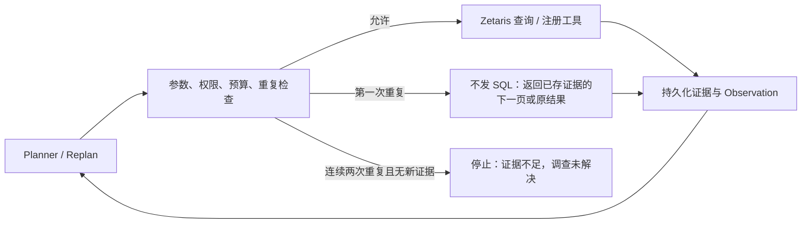

# Agent 执行保护与追踪

Planner 继续负责调查动作选择和 Replan。执行 Harness 独立负责动作合法性、重复检查、预算和终止，避免把固定业务调查顺序写入 Planner。

## 执行规则

- 动作指纹包含工具、规范化参数、实际时间窗口、账户、数据快照和规则版本。参数顺序不同不会产生新动作。
- 已完成的相同动作禁止再次调用数据源。若原证据还有未展示的明细页，直接返回下一页（每页 30 行，不发 SQL）；否则在本步内拒绝，并把"该工具+参数已完成、其他工具和范围仍可用"的明确反馈交给一次修复调用。出现新进展后清除旧拦截反馈，packet 另列 completed_actions。
- 新账户、新窗口允许查询。不同范围都返回空结果仍然属于新的负面证据，不会仅因结果相同被判断为停滞。
- 连续两次被拦截或两次观察都无新证据时，不再直接终止，而是设置强制 finish：下一步决策语法只允许 finish，由模型基于已有证据给出结论和候选判断（trace 记录 finish_forced）。翻到未展示的新页面算新观察。
- 剩余模型调用只够一次修复、动作预算用尽或达到 Markovian maxChunks 前一轮时，决策 schema 只允许 finish，避免案件停在 running 或只剩 budget_exhausted。
- Replan 必须同时给出下一个动作。模型语法中所有字符串和数组都有上限（workflow.output_bound 测试保证最坏输出低于单请求预留）；截断时只记录停止字段和尾部形态，不保存原文。
- 案件墙钟从首次执行 step 开始计时，不从建案时刻计时。
- 没有新增 Observation 时禁止连续 Replan，防止改写计划成为另一种空循环。
- 保留已有请求数、SQL 数、动作数、时间和 Token 预算；保护层不额外调用评审模型。

## Meterless 能力边界

| 能力 | 使用方式 |
|---|---|
| Markovian | 已接入官方参考实现的分步运行、停止条件及历史持久化；不假设参考实现存在文档中所有示意 API |
| H-MEM | 存储按案件、数据分区隔离的调查记忆；不替代持久化动作执行账本 |
| Scout Intent Guard Stack | 采用其结构化 allow/block、策略版本和原因的设计；领域重复检测由本项目实现 |
| Scout Intent Eval Harness | 官方提供评估规范与运行器约定，需要接入自己的 Scout 实现和任务样本；不能直接证明 AML 调查质量 |

参考：[Guard Stack](https://github.com/Meterless/Meterless/blob/main/engines/scout-intent/docs/risk-and-policy.md)、[Eval Harness](https://github.com/Meterless/Meterless/blob/main/engines/scout-intent/docs/eval-harness.md)、[Markovian Telemetry](https://github.com/Meterless/Meterless/blob/main/engines/markovian/docs/telemetry.md)。

## Tracing

本地 SQLite 记录执行事件；没有引入外部收费观测服务。事件包含 run、span、父 span、状态版本、模型名称、输入包哈希、供应商返回的 Token 用量、耗时、工具指纹、证据引用、完整性及拦截原因。没有保存原始 Prompt、密钥、交易明细或隐藏推理文本。模型调用失败可能只有开始事件；结合最终步骤状态判断失败，不能把没有完成事件解释为成功。

查询命令：`PYTHONPATH=services/aml-api .venv/bin/python -m aml_agent.cli trace RUN_ID`。
接口：`GET /v1/runs/{run_id}/trace`，与其他本地运行接口使用相同认证。

## 校准与验收

先使用不调用模型的回归测试确认：重复动作被阻止、新范围不误拦截、空结果不误判、重复动作没有第二次 SQL、停滞状态正确。随后在固定 development 案件上测试真实 Planner，统计重复动作率、拦截后恢复率、有效完成率、停止率和模型用量，再调整提示与动作 Schema。验证集只用于冻结后的比较，测试集保留最终验收。

当前新增回归测试通过。真实模型的恢复率和业务调查质量仍待新一轮固定样本验证；执行保护不能保证 Planner 自动选择正确的下一步，也不能当作反洗钱效果提升的证据。

## 信息缺口驱动的 Planner 与细粒度工具（1.1）

Planner 输入增加全部已执行查询的覆盖摘要（范围、完整性、实际行数、按币种的本账户流入流出统计），以及已注册但尚未独立查询的账户集合。后者是可选调查分支，不是固定流程或风险排序。

- 工具已合并为 7 个，每个对应一个调查问题，见技术规范 4.2.2。`summarize_account` 一次扫描给出规模、频次和对手分布；`check_structure` 由 Zetaris 按跳迭代追踪 2–5 跳资金路线（金额连续性剪枝，束宽 3，最多 60 节点），实测每跳约 25–30 秒。
- 规则告警案件在首个模型决策前由程序预取 `get_alert_context`，并登记前 5 个支持对手账户。
- 明细上限由程序固定为 200 行；重复同一明细查询由程序返回下一页。Zetaris 连接失败、5xx、429 由程序重试一次并计入 SQL 预算；超时不重试（服务端可能仍在执行）。
- 完整且覆盖请求窗口的证据已显示某方向没有交易时，相应查询/追踪直接返回 empty_by_prior_evidence，不发 SQL。
- 模型输入用列式表：canonical_transactions 最多 30 行、edge_summary 最多 25 条、candidates 最多 12 笔；packet 含 question_status 与 completed_actions。

每个动作的 expected_observation 应说明尚未解决的问题、需要获取的事实，以及不同结果将怎样改变下一步。完整查询只有一笔不等于被截断；该查询范围内的零出账可以确定，但不能外推到其他支付方式或未来时间。拦截只影响相同动作，不能被解释为全局停止查询。
