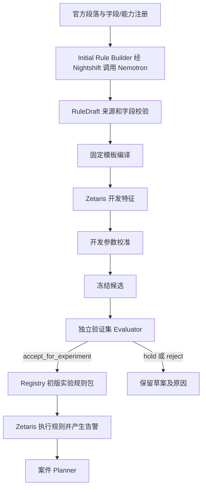
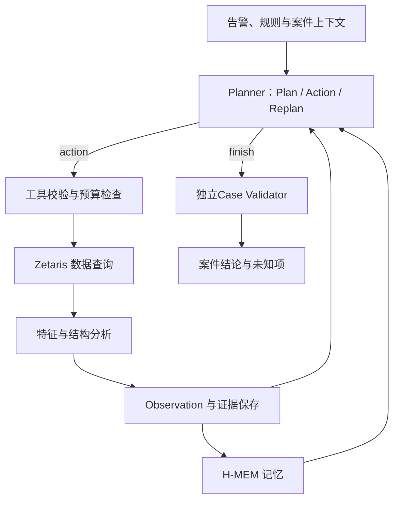
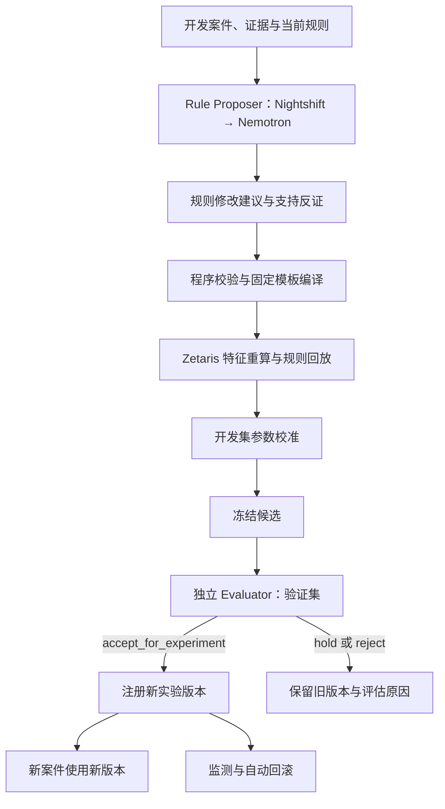

# 交易风险调查 Agent 技术实现规范

本文按“总体方案 → 数据基础 → 整体流程 → 分阶段实现 → 支撑机制 → 接口附录”组织。第 1–3 节说明系统如何运行，第 4 节定义三个业务阶段的实现，第 5–8 节规定上下文、评估、状态及验收，第 9 节集中列出开发接口。

当前验证状态见第 8.1 节，实施任务见第 8.2 节。本文定义目标实现，不表示全部功能已完成；配置文件中的参数仍需应用实现执行与校验。

## 1. 总体方案

系统从可追溯的 AUSTRAC 指标生成可计算规则草案，利用 Zetaris 计算开发特征，在隔离环境校准并验证初版规则包。规则执行产生告警后，由 NVIDIA 模型驱动案件规划、动作选择和 Replan，通过 Zetaris 逐步取证。开发案件可触发规则修订；独立 Evaluator 决定候选接受、暂缓或拒绝。

首版交付为可复现的研究/实验系统。规则接受状态为 `accept_for_experiment`，不等同生产部署资格。全局规则版本、模型/提示词版本、数据快照与评估样本必须可追溯。

### 1.1 固定技术选型

| 层 | 选型 | 实施要求 |
|---|---|---|
| 数据与特征执行 | Azure VM 上已有 Zetaris；Lightning SQL / REST | 复用已注册 HI-Large；聚合、窗口及有界关系连接优先在 Zetaris 执行 |
| 模型服务入口 | Meterless Nightshift Runtime | 作为应用主要 provider；NVIDIA 凭据配置在 Nightshift |
| 默认模型 | NVIDIA `nvidia/nemotron-3.5-lightning-30b-a3b` | 经 Runtime 实际发现的 Nemotron lane 调用；保留底层模型回执 |
| 深度模型 | NVIDIA `nvidia/nemotron-3.5-super-vl-120b-a12b` | 可选；通过能力与预算验收后启用 |
| 执行循环 | Meterless Markovian 官方参考实现 | 固定 commit；复用 stepFn、carryover、轮数与停止机制 |
| 记忆 | Meterless H-MEM 官方参考实现 | 固定 commit；业务服务实施案件/时间/样本隔离 |
| 编排与模型适配 | TypeScript / Node.js / Ajv | 调用 Runtime、校验决策、接入 Markovian/H-MEM |
| 业务 API 与计算适配 | Python / FastAPI / Pydantic | 复用现有查询/评估代码；固定模板、证据、状态、规则编译 |
| 状态存储 | SQLite WAL，Python 服务唯一写入 | 以事务保存证据、动作、版本、预算；不引入消息中间件 |
| 展示 | Web 界面或首轮 CLI | 仅调用业务 API；不持有外部服务密钥 |

首版不使用强化学习、模型参数训练、任意模型生成 SQL、全表无限深度图遍历或自动付费回退。其他模型 provider 不属于 v1.0 必须实现范围。

## 2. 数据基础与分析能力

### 2.1 调查字段

| 字段 | 类型/语义 |
|---|---|
| transaction_id | 稳定 bigint，一基原始行号；与 snapshot 组合引用 |
| transaction_time | 时间戳；当前数据到分钟，不推断真实秒序 |
| from_bank/from_account | 付款银行/账号字符串，保留前导零 |
| to_bank/to_account | 收款银行/账号字符串，保留前导零 |
| amount_received/receiving_currency | 收款金额 Decimal(38,8) 及币种 |
| amount_paid/payment_currency | 付款金额 Decimal(38,8) 及币种 |
| payment_format | 支付格式字符串 |

`is_laundering`、发布方模式答案和回顾性选样信息仅进入评估域。账号≠客户身份，币种/银行≠地理位置，时序连接≠同一资金。

调查身份必须无法读取标签。现有管理员 key 的无标签视图仅实现开发程序隔离；数据接入必须验收最小权限。平台不能实现所需隔离时，使用无标签物理来源和独立凭据，评估进程保留原始来源访问。

### 2.2 计算职责

| 需求 | 首选执行位置 | 首版范围 |
|---|---|---|
| 次数、金额、distinct 对手数、首末时间 | Zetaris GROUP BY/COUNT/SUM/MIN/MAX | 按银行+账户、方向、窗口及币种定义口径 |
| 历史变化、交易间隔 | Zetaris 窗口/历史查询 | LAG 已验证；其他表达式逐项兼容性验收 |
| 汇集/分发 | Zetaris 聚合 | 保留不同对手与交易引用 |
| A→B→C、固定深度回流候选 | Zetaris 有界自连接 | 严格递增时间、不同交易 ID、显式深度/账户限制 |
| 固定特征准备和质量流程 | Zetaris Pipeline | Projection/Join/Aggregation/Custom SQL；先验证具体节点/接口 |
| 平台未覆盖的复杂图算法 | 项目确定性算法 | 仅处理已授权的有界证据子图；不得另开本地 Spark 冒充 Zetaris |

Zetaris 原生任意深度图遍历、社区发现和最短路接口未确认，不纳入首版承诺。可视 Pipeline 的计算依赖图不作为账户交易图使用。SQL 能力验证不替代 GUI Pipeline 或全量性能验收。

### 2.3 特征注册表

每个特征登记 feature_id/version、类型、单位、方向、币种策略、缺失语义、required_history、模板版本、data_as_of、代码版本和验证样例。历史未覆盖返回 insufficient_history，不填零。跨币种金额不求和；跨币种对手数仅在规则声明该口径时计算。

先执行按账户/窗口的完整聚合并缓存。派生账户日特征按 snapshot/feature_version/closed_at 管理：案件截止到中午时，不可使用当天全天聚合。允许完整历史桶加当前部分桶实时计算。新增物化表、Pipeline 或源数据重排由数据工作包实施并验证，不作为模型运行时任意动作。

## 3. 整体业务流程

系统按三个阶段运行：初版规则形成可执行告警入口；案件调查围绕证据逐轮推进；跨案件规则更新在独立评估后形成新版本。

### 3.1 初版规则生成与告警

输入为 AUSTRAC 来源、IBM 字段和已支持特征模板。NVIDIA 生成规则草案，程序编译，Zetaris 计算特征，隔离程序校准并验证，只有通过的实验规则包才产生告警。

输出为版本化 RulePackage、告警及支持证据。字段、阈值和校准细则见第 4.1 节。

### 3.2 案件调查循环

Planner 使用 NVIDIA Nemotron，统一经 Nightshift 调用。每轮根据 Observation 选择查询、分析、Replan 或结束；Zetaris 执行查询及可计算分析，Markovian/H-MEM 承担执行循环、上下文承接与记忆。

输出为带证据、反证、未知项和停止原因的案件结论。Planner 协议、工具与单步执行见第 4.2 节。

### 3.3 跨案件规则更新

开发案件触发修改建议，经过编译、Zetaris 回放、开发校准和独立验证后决定接受、暂缓或拒绝。规则模型只提出建议，Evaluator 独立决定是否允许注册实验版本。

输出为新实验版本或保留旧版本的评估记录。规则修改范围、版本固定及回滚细则见第 4.3 节。

## 4. 分阶段实现细节

本节定义第 3 节三个流程的输入、输出、约束和执行细节。模型调用统一遵守附录 9.1，业务端点与数据契约统一遵守附录 9.2。

### 4.1 初版规则生成

Initial Rule Builder 经 Nightshift 调用 Nemotron，输入为已登记的政策段落、字段字典、特征/模板能力和规则 schema，输出 RuleDraft。模型不读标签；规则编译、参数校准与独立验证依次执行，未完成校准的草案不可产生正式告警。

#### 4.1.1 Policy Registry 与候选指标

Policy Registry 为每个段落登记 source_ref、官方 URL、章节/段落定位、取得日期、原文快照及 SHA256、适用行业、版本和有效性检查。模型生成的政策主张必须回指可解引用段落。

当前 IBM 指标映射如下。编号是项目映射，不是法规条款号；行业前提缺失时只能覆盖可观测行为。正式实现以实际原文逐段登记和字段校验为准。

| 项目映射 | 行为家族 | 主要边界 |
|---|---|---|
| IBM-MAP-R01 | 快速/多账户转移 | 复杂程度为项目定义 |
| IBM-MAP-R02 | 接收后转发 | 不证明同一资金 |
| IBM-MAP-R03 | 多来源汇集 | 缺客户及行业身份 |
| IBM-MAP-R04 | 短时大额入账 | 阈值需校准；缺业务身份 |
| IBM-MAP-R05 | 模式/频次异常 | 需要历史基准 |
| IBM-MAP-R06 | 金额/频次异常 | 需要同口径历史及业务背景 |
| IBM-MAP-R07 | 快速往返 | 无法判断经济理由 |
| IBM-MAP-R08 | 活动突变 | 无法解释变化原因 |
| IBM-MAP-R09 | 小额聚集/疑似拆分 | 无法确认规避意图或原始大额 |
| IBM-MAP-R10 | 观察静默后活跃 | 无法证明真实长期休眠 |
| IBM-MAP-R11 | 多笔小额付款 | 缺保险业务与意图 |
| IBM-MAP-R12 | 转出后部分返还 | 缺虚拟资产业务，不能证明同一资金 |
| IBM-MAP-R13 | 整额形态偏离历史 | 仅数值及历史异常 |
| IBM-MAP-R14 | 多个账户汇入 | 不证明不同实际所有人 |

共享家族可合并特征，政策引用仍分别保留，禁止重复加权。PaySim 历史规则的 R01 等编号不迁移为 IBM 同名规则。来源与规则均使用数据集/命名空间。

#### 4.1.2 RuleDraft / RulePackage

RuleDraft 必填：schema_version、rule_id、dataset、source_refs、policy_indicator_refs、behavior_family、template_id/version、field_bindings、feature_ids、expression、parameters、parameter_basis、scope、self_transfer_policy、currency_policy、required_history、missing_context、coverage、status、support_evidence_spec。

`coverage` 为 full/partial/unsupported/needs_history。参数依据为 policy_explicit/project_constraint/needs_calibration。policy_explicit 必须有原文数值引用；needs_calibration 的值为 null，不允许执行。缺字段或未知模板返回 unsupported/feature_request，不生成任意代码绕过限制。

Rule Compiler / Registry 对已支持草案生成固定模板执行计划。参数校准完成后冻结为 RulePackage，包含 source/feature/template/compiler/config/parameter 版本与 SHA、开发/验证 manifest、评估记录和作用域。

#### 4.1.3 首批模板与校准

首批模板为 fan_in、fan_out、receive_then_send。初始实验范围为 ACH/Wire、排除自转账、严格后续时间与不同交易 ID；支付格式属于项目约束，不是 AUSTRAC 规定。模板与指标关联由 Policy Registry/Initial Rule Builder/Rule Compiler / Registry 核验，不宣称覆盖全部指标。

- fan_in/out：窗口 24/48 小时、distinct 对手数 3/5/10，各六个配置，加停用各七种。
- receive_then_send：最大间隔 6/24/48 小时，加停用四种。
- 合并参数组合最多 `7×7×4=196`。这是开发初始搜索空间，不是已校准最优参数。

特征与结构分析工具在开发范围内优先批量计算可复用统计；独立 Evaluator 派生并比较组合，禁止默认发起 196 次全表扫描。校准只使用开发集；标签仅由隔离 calibration worker 读取，不进入规则模型提示词。

告警按焦点账户/观察日合并，保留所有触发模板及支持边。完整历史不满足所需窗口则不可评估。开发处理预算初值为每日最多 50 个合并告警；如果只评估抽样账户，该预算仅对样本成立。满足预算下优先开发正例覆盖，再按 precision/查询负担作预先定义的并列决胜。

初版独立验证与预登记简单基线和停用方案比较。数据不足或无可接受规则时保持 needs_calibration/hold，不发布可执行包。首版通过后注册 experiment_v1，再生成规则告警。人工固定 baseline 和显式账户调查必须单独标记。

### 4.2 案件调查

#### 4.2.1 Planner 决策契约

Planner 输入 EvidencePacket、冻结规则、适用政策、当前计划、允许工具、账户/窗口引用和剩余预算。初次调用输出 2–4 个可检验问题及第一个动作；后续调用合并观察解释和下一动作选择。

决策公共字段：schema_version、decision、based_on_state_version、plan_version、brief_reason、evidence_refs。

| decision | 附加字段 | 行为 |
|---|---|---|
| action | initial_plan（仅首次）、goal_updates、next_action | 更新目标状态并选择一个动作 |
| replan | previous_plan_version、plan_patch、next_action（可空） | 修订未完成问题/分支，保留旧计划，计一次 Replan |
| finish | conclusion、supported_findings、counterevidence、unresolved_questions、stop_reason | 调用Case Validator 结束校验，不再执行查询 |

`next_action` 含 tool、arguments、expected_observation。参数必须满足工具专用 schema，引用必须属于本 run；禁止任意 SQL、shell、改写截止时间或读取标签。模型只输出简短行动依据，不保存隐藏思维链。

Replan 由模型针对新分支、假设不支持、矛盾、历史不足或规则不适配决定。程序提供截断/错误/预算事件，但不把固定扩窗顺序写成业务策略。每次调用可选择在授权窗口内改变调查方向；未知范围不解释为无交易。

#### 4.2.2 工具清单

以下均为项目工具，由业务 API 接收决策后路由；名称不是第三方原生端点。

| 工具 | 输入 | 主要输出 | 执行与能力 |
|---|---|---|---|
| get_alert_context | alert_ref | 命中规则、来源、支持边、版本与截止时间 | 业务 API / Rule Registry |
| summarize_account | account_ref、window_ref、direction | 按方向/币种统计与覆盖 | 特征与结构分析工具 → Zetaris 聚合 |
| query_account_transactions | account_ref、window_ref、direction、cap | 排序交易与完整性 | Zetaris Adapter → Zetaris 固定 SQL |
| compare_account_baseline | account_ref、current/history_window_ref | 同口径变化或 insufficient_history | 特征与结构分析工具 → Zetaris 历史/窗口 |
| query_between_accounts | 两个已见 account_ref、window_ref | 直接/反向交易引用 | Zetaris Adapter → Zetaris 有界查询 |
| check_structure | evidence_refs、checks、scope | 可验证的时序路径或结构 | 特征与结构分析工具 → Zetaris 有界连接；必要时项目算法 |
| get_evidence | evidence_refs、允许字段 | 已授权、未展示证据 | 业务 API 证据库；缺失数据走受控 Zetaris Adapter 查询 |
| propose_rule_change | 冻结 base_version、证据、假设 | 已保存提议 ID | 业务 API 候选队列，不发布 |
| finish_case | 结构化结论与引用 | Case Validator 结果 | Case Validator，无标签 |

`checks` 注册 temporal_path、fan_in、fan_out、gather_scatter、scatter_gather、round_trip、partial_return、cycle。仅暴露已实现并测试的子集；其余返回 unsupported。小额聚集、整额偏离和历史异常用对应特征工具，不能用图连接替代。

#### 4.2.3 单步执行与恢复

编排器在 Markovian stepFn 内执行：读取并核对 state_version → 检查预算/取消 → H-MEM 授权检索 → 业务 API 构造业务证据 → 模型适配器调模型 → schema 校验 → 业务 API 事务化接收决策并至多执行一个业务动作 → Case Validator 校验 → 保存 Observation/预算/版本 → 返回 checkpoint。

Markovian 负责通用循环、carryover、最大 chunk 和停止；业务 API 负责精确状态、证据、作用域与幂等。H-MEM 写入通过 outbox，失败不重跑已完成查询。恢复时先检查动作状态；同 action_id 不重复执行。原子 lease/fencing 防止过期编排器提交。

case 结束状态：completed、insufficient_evidence、budget_exhausted、tool_failed、model_unavailable、cancelled。completed 仅表示调查流程结束，不是确认洗钱。模型不可用时不将固定程序结果标记成 AI 调查。

### 4.3 跨案件规则更新

#### 4.3.1 修改建议输入与输出

Rule Proposer 仅读取开发案件及其证据摘要，输出 base_version、operation、policy_refs、支持/反例、表达式差异、预期收益、负担和未知项。案件模型的 propose_rule_change 仅保存提议。

#### 4.3.2 可修改范围

v1 必须支持阈值/窗口修改、已有条件增删和 all/any 组合；新增规则使用新 ID，停用保留审计。新增特征和加权/分组复杂表达式须先完成独立 extractor/DSL/schema/测试工作包再开放。模型不得提交任意执行代码。

#### 4.3.3 编译、评估与实验版本

修订路径：提议 → Rule Compiler / Registry 编译与适配检查 → 独立 Evaluator 开发校准 → 冻结 → 独立验证 → 自动接受/暂缓/拒绝 → Registry 实验包。bootstrap 不带 base_version，revision 必须带；不能覆盖已冻结来源解释。接受版本只影响新案件，旧案件继续原包。

#### 4.3.4 版本固定与回滚

版本登记保存父版本、差异、评估和回滚目标。上线实验前冻结告警量/资源错误/性能的回滚阈值；触发后自动回指旧包并保留新版本记录。未配置可验证回滚门槛时不得开启自动实验发布。

## 5. 上下文、记忆与运行预算

### 5.1 证据数据路径

Zetaris 原始数据 → 完整授权聚合/有界关系计算 → 业务证据存储 → 本轮 EvidencePacket。交易全集不输入模型，不对全表 embedding 代替精确交易查询。

Packet 必须包含 run/state/version、as_of、允许范围、当前规则与问题、最新 Observation、完整性、支持和反证、frontier 引用、未知项、剩余预算及检索记忆来源。

### 5.2 展示与查询完整性

默认每轮最多展示 30 条相关交易、15 个节点、25 条摘要边，仍受 token 预算约束。这些为可版本化展示参数，不是免费 API 权益或模型容量。优先触发边、边界、支持/反证和模型明确索取的证据，记录 selection_reason、rows_shown 与 omissions。

完整聚合的真实总量不从展示样本推算。源查询、实际取回明细和本轮显示范围分别记录；未展示证据可用 get_evidence 检索。若明细取回不足或窗口未覆盖，必须保留 partial/unknown，不将其转成完整否定证据。

### 5.3 能力归属

| 内容 | 直接复用 | 项目适配 |
|---|---|---|
| 跨轮压缩、carryover、轮数 | Markovian | 短 checkpoint 与事实引用，不重写通用摘要循环 |
| 记忆检索 | H-MEM | tenant/case/split/as_of/版本过滤 |
| 模型服务与路由 | Nightshift | 发现、账号配置、能力探测与回执 |
| 交易相关性、范围与完整性 | Zetaris + 业务 API | 业务 EvidencePacket 与反证选择 |
| 真实调用用量与案件预算 | 可用 provider/Runtime usage | 预扣/结算、SQL/图/时间边界，未知用量保守记账 |

业务库保存精确事实；carryover/H-MEM 只用于上下文导航和记忆。模型摘要不覆盖金额、时间、证据覆盖和待办状态。默认不启用模型 compressor；启用后所有压缩调用经模型适配器 预算接口并计入该 run。

### 5.4 Token、查询与运行预算

配套 JSON 为配置唯一参数源；以下数值为 v1.0 开发 profile，变更须记录 config_version。模型/网关/账号限制更严格时取更低上限。

| 维度 | 默认值 |
|---|---:|
| 单请求输入目标 / 硬限 | 8000 / 12000 tokens |
| 单请求总输出含可计量推理 | 2048 tokens；可见 JSON 目标 800 |
| 单案件实际模型 HTTP 请求（含修复/重试/模型压缩） | 10 |
| 单案件输入 / 输出总限 | 120000 / 20480 tokens |
| 业务工具动作 / Replan | 8 / 2 |
| 物理 SQL 请求（含重试与分片） | 16 |
| 模型 / SQL 并发 | 各 1 |
| 单明细保留 / overflow 探针 | 200 / 201 行 |
| 历史 / 图深度 / 案件账户 | 截止前 7 天 / 3 / 20 |
| 单次新增账户 | 5 |
| 单案件派发截止 | 720 秒；派发前预留请求 timeout |
| 模型 / SQL 客户端等待上限 | 各 180 秒 |
| SQL 正常延迟目标 | 30 秒；不表示服务端取消 |
| 单动作重试 / 单输出修复 | 各最多 1 次，仍受全局限额 |
| 案件 Markovian | chunkSize=16000，maxChunks=10，carryoverTokens=1024，overlapTokens=0，reflect=false |
| 初版构建模型请求 / maxChunks | 各 12；每批最多 4 条政策指标 |
| 初版/修订参数组合 | 196 |
| 初版/修订批任务 SQL / 墙钟 / 样本窗口上限 | 64 次 / 1800 秒 / 10000 个账户窗口，必须提供冻结 manifest |
| 规则修订模型请求总上限 | 12 次（含修复/压缩）；base_version 必填 |
| worker lease / 续约间隔 | 420 / 30 秒；提交必须携带 fencing token |
| 可选模型 reviewer | 默认关闭；若启用另设至多 2 次请求预算 |
| 付费回退 / fusion | 关闭 |

输入计数使用对应 tokenizer；不可得时采用保守估算并标 estimated，实际 usage 标 measured。最终请求包装后再检查，不能用字符数除四当准确计费。超过软限先去重、使用官方 carryover、减少展示与记忆；必须保留截止时间、权限、完整性、反证和未知项。仍超硬限则不发请求，返回 context_budget_exceeded。

调用前事务预扣最坏额度；返回后结算。缺 usage 不记零。401/403 不重试；429 按 Retry-After 且受剩余时限限制；超时核查 tool/model call 状态后再重试。达到派发截止不派新请求，在途查询另列 outstanding。

NVIDIA 公开页面当前提供免费原型端点，但账号资格、配额、Nightshift 权益必须实测。规则更新批任务使用独立 run ledger，不借用案件剩余额度；重用每请求 profile 和统一预算 adapter。调用成本按实际 provider/model/usage 单独计量，基础设施费用单列。

## 6. 独立校验与效果评估

### 6.1 在线 Case Validator

Case Validator 不读标签，核查作用域、截止时间、字段口径、查询覆盖、结构的确定性验证和结论引用。返回 pass/needs_evidence/invalid。结束结论需逐项列支持、反证、未知及停止原因；partial 不允许穷尽式否定。

可选模型 reviewer 使用独立 prompt/调用，仅提供语义意见，不能替代事实校验或批准全局规则。其用量进入独立账本。

### 6.2 样本与指标

划分调试回顾性样本、开发集、冻结验证集、最终测试集。调试正例按标签选样时不得报告总体效果；已经查看的样本不得重新当作独立验证。候选与评价准则在查看验证结果前固定；反复针对验证优化需新的保留批次。

时间切分遵守 data_as_of，检查关联账户/网络组件跨集泄漏。必要时采用账户/组件隔离和 purge/embargo；不满足独立性时披露并按关联组件重采样。人为平衡的正负样本不直接估计总体 precision；分层样本保留采样概率与权重。

指标分开：规则账户窗口/支持交易 precision-recall；调查证据或已知链路覆盖；Planner 有效动作、非法参数/引用、事实性、停止质量；物理查询、延迟、token 和费用。只有存在可对齐真值时计算完整链路指标。

等告警预算比较规则，等工具/时间预算比较调查。无正例时 recall=null；样本不足、证据不全或区间过宽返回 hold。不能用账户某笔标签阳性证明模型已定位该笔或重建完整链路。

### 6.3 自动实验版本准则

硬门槛：schema/来源/字段/模板合法，无标签与未来泄漏，币种/缺失语义正确，证据覆盖合格。实验初值：验证至少 100 个账户窗口和 10 个正例；完整证据；等预算下真阳性提高且 precision 不降低。此门槛不构成生产资格；正式发布前仍须确定统计区间、场景覆盖、性能与回归标准。

输出 `accept_for_experiment` / `hold` / `reject`，附 metrics、scope、completeness、failure_codes、版本与 manifest。缺证据为 hold；违反硬约束为 reject。接受后 Rule Compiler / Registry 自动注册实验包；首版 production_eligible=false。该流程不设置人工审批步骤。

## 7. 状态、版本与权限

业务 API 最少实现 sources、feature_registry、rule_drafts、rule_packages、alerts、cases、plans、case_steps、tool_runs、evidence、observations、model_calls、budget_ledger、jobs、memory_outbox。评估标签及 evaluation_results 保存在隔离访问域，展示结果经去标签接口发布。

事务提交顺序必须保证：已返回给模型的证据已持久化；state_version 单调增加；动作、预算与 observation 同步提交；规则发布和当前版本指针原子更新。H-MEM/Markovian history 不作为唯一事实源或事务日志。

每个 run 固定规则版本；新版本只用于新案件。日志保存 SQL 模板/参数、source/version/hash、模型 route/底层 model/usage、prompt/schema/config hash、action/query ID、错误/取消和回执。禁记密钥、原始 connect link 与不可访问标签。

## 8. 实施与验收

### 8.1 当前验证状态与复用入口

| 已验证项 | 复用入口/记录 | 限定范围 |
|---|---|---|
| HI-Large 注册及来源信息 | `sources/ibm_hi_large_manifest.json`；`docs/IBM_HI_Large_Zetaris.md` | v8，179702229 行；不表示本轮全表调查 |
| Zetaris 账户明细与范围检查 | `prototype/zetaris_baseline.py` | 固定 SQL、200+1、截止时间与银行/账号检查 |
| 确定性规则/结构/评估 | `prototype/baseline.py` | 人工基线，非模型生成 |
| 实际基线 | `analysis/README.md` | 五账户双窗口，10/10 无截断，候选 hold |
| 正例回顾性诊断 | `analysis/README.md` | 三正例五对照，非盲测，候选 hold |
| 聚合、LAG、有界自连接 | `analysis/zetaris_feature_capability_probe.sql`；`analysis/README.md` | 三条只读 SQL 通过；非 GUI Pipeline/全量图性能验收 |
| Python 契约测试 | `python3 -m unittest discover -s prototype/tests -v` | 当前记录十项通过；不是模型联调验收 |

未完成项：真实模型/Nightshift 接入；官方 Markovian/H-MEM 集成；初版政策规则生成与编译器；完整内部 API；独立正式样本评估；实验 Registry 发布/回滚；生产权限隔离。

数据环境验证必须先执行仓库 preflight。运行仓库脚本还需遵守对应 `AGENTS.md`；身份无权限时报告缺失项，不替换凭据绕过。团队共享版本不包含本机凭据、SSH 私钥或用户下载目录。

### 8.2 实施任务与集成顺序

#### 8.2.1 实施任务

| 任务 | 计划交付路径 | 依赖 | 验收关键项 |
|---|---|---|---|
| WP01 契约与存储 | `schemas/`、`services/aml-api/` migrations、版本注册 | 本规范 | schema/状态机、事务、409/幂等/lease 测试 |
| WP02 模型与 Runtime | `services/orchestrator/provider/` | 账号与 Nightshift；WP01 预算接口 | models/chat、错误认证、结构化输出、真实 Nemotron 回执与用量 |
| WP03 Zetaris 工具 | `services/aml-api/zetaris/`、`sql/features/`、`sql/tools/` | 现有实例；WP01 | 聚合/明细/历史、完整性、scope、无标签、查询性能 |
| WP04 政策与初版规则 | `policies/`、`prompts/rule-builder/`、`services/aml-api/rules/`、`schemas/rule-draft.schema.json` | WP01/02/03 | 来源逐段映射、参数空位、缺字段/行业限制、编译验证 |
| WP05 调查 Planner | `prompts/planner/`、`schemas/planner-decision.schema.json`、`services/orchestrator/planner/` | WP01/02/03 | 初始问题、不同观察产生不同动作、Replan、合法终止 |
| WP06 Meterless 集成 | `services/orchestrator/engines/`、受控官方源码锁 | WP01/02/05 | 唯一外层循环、H-MEM 过滤、outbox、恢复、reflect=false、conformance |
| WP07 校准与评估 | `evaluations/`、manifest、metrics、calibration worker | WP01/03/04 | dev 校准、冻结验证、标签隔离、统计/预算口径、hold/reject |
| WP08 规则闭环 | `services/aml-api/registry/`、`prompts/rule-revision/`、rollback | WP04/06/07 | base_version、候选差异、自动实验版本与回滚 |
| WP09 展示与回执 | `apps/dashboard/` 或 CLI | WP01；逐步接入其余 | 来源→告警→Plan→证据→评估全链路，状态真实 |

以上路径为目标实现位置；除第 8.1 节列出的文件外，不代表已经存在。各实现任务可以并行准备，但不得更改公共 schema、端点或状态字段而不更新契约和版本。首轮不启动模型多角色并发，代码分工不改变运行并发限制。

#### 8.2.2 集成顺序

1. 冻结 WP01 的 schema、内部 API 和配置；以 mock 对接模块。
2. 验证 WP02 的真实模型连接；完成 WP03 的无标签工具。
3. WP04 → WP07 完成初版构建/校准/独立验证；未通过时保留草案。
4. WP05 → WP06 完成真实模型动态调查；只允许已验收工具。
5. 按冻结规则产生告警；没有可用规则时可运行明确标记的手动账户调查，不替代自动告警验收。
6. 独立保留样本比较 baseline 与模型调查，记录质量、延迟、token 与预算。
7. WP08 验证接受和拒绝/暂缓分支及回滚；WP09 展示完整回执。

#### 8.2.3 必须提供的验收材料

每个工作包提交 commit、接口/schema/config 版本、测试命令与结果、mock/live/replay 类型、官方能力调用位置、未完成项和失败码。模型相关工作附底层模型回执；SQL 相关工作附模板、scope、完整性与耗时。

关键场景：来源缺失、未知字段/特征、阈值未校准、partial/empty/error 区分、展示裁剪后续取证、未来范围/未知账户拒绝、同分钟交易不伪造顺序、重复动作/崩溃恢复、预算耗尽、模型不可用、标签不可访问、降噪但漏正例的候选 hold/reject、版本固定与自动回滚。

### 8.3 展示与运行回执

展示初版规则来源/适配/参数状态，告警来源，案件问题与 plan 版本，每步工具、简短依据、Observation 覆盖与证据，已验证结构与未知项，剩余预算、模型回执、规则评估和版本差异。

必须区分真实模型、deterministic baseline、mock 和 replay。仅 healthz 成功不显示模型已就绪；仅生成规则文本不显示规则已发布；查询/显示裁剪必须可见。前端 不在浏览器保存模型、Runtime、内部服务或 Zetaris 密钥。

## 9. 附录：调用接口与数据契约

本附录用于开发对接；阅读业务流程时不需要先理解端点、认证和幂等细节。外部服务接口与本项目待实现接口分别列出，不相互替代。

### 9.1 外部服务接口

#### 9.1.1 Meterless Runtime

| 项 | 契约 |
|---|---|
| 基地址 | `METERLESS_BASE_URL`；从 Nightshift Console 获取，规范化为 `origin/v1` |
| 发现 | `GET {METERLESS_BASE_URL}/models` |
| 文本生成 | `POST {METERLESS_BASE_URL}/chat/completions` |
| 认证 | `Authorization: Bearer <METERLESS_RUNTIME_TOKEN>` |
| 应用标识 | 每次请求 `meterless-app: aml-investigator`；chat 请求另加 `meterless-scope: user` |
| model 字段 | 从发现结果选择真实 `meterless/*` 路由；不得用底层 NVIDIA ID 替换路由 ID |
| 内容 | `messages` 的普通文本字符串；返回单一 JSON 对象，再经项目 schema 校验 |
| 超时 | 180 秒；调用前预留该时间和最坏 token 用量 |
| 凭据位置 | NVIDIA key 只进入 Nightshift Providers；应用仅保存 Runtime token |
| 验收 | 错误 token 显示 unauthorized；发现成功；真实模型响应；底层 Nemotron 回执 |

不重复拼接 `/v1/v1`。`/healthz` 只检查进程，不证明模型可用。原生工具调用、严格 JSON Schema、thinking 参数和完整 usage 为待探测能力；在通过兼容性测试前使用普通文本 JSON 协议。响应无法解析不得执行工具，最多修复一次且计入预算。

接入依据为 Meterless live Power Prompt 与实际安装版本。初始化时记录 runtime_version、provider_contract_version、路由目录、支持参数和用量可见性；通过验收后冻结。只启用明确审核过的免费 Nemotron lane；关闭 fusion、不可见级联和付费回退。账号权限与 RPM/TPM 需在模型接入时核实，不视为自动获得参赛额度。

#### 9.1.2 Zetaris REST

| 项 | 契约 |
|---|---|
| 基地址 | `ZETARIS_REST_URL`，现有配置形态为 `http://localhost:8888/api/v1.0`，经 SSH 隧道到 Azure |
| SQL | `POST {ZETARIS_REST_URL}/sql-editor/sqls/run` |
| headers | Bearer API key、数字 `X-Org-ID`、每次新 UUID 的 `X-Request-ID`、JSON Content-Type |
| 请求体 | `queryId`：UUID；`sql`：单条已编译 SQL；`source`：`SqlEditor`；`limit`：显式整数 |
| 已验证响应 | JSON 对象的 `data` 为行数组；数值/时间可能为字符串；必须按字段字典解析 |
| 连接检查 | `GET /datasource/datasources`、`SELECT 1`、`SHOW LIGHTNING DATABASES`；使用仓库 preflight |
| 调查源 | `aml.transactions` |
| 评估源 | `IBM_AML.hi_large_transactions`，仅评估访问域 |

每个请求一条语句、不带尾分号；银行/账户保留字符串，金额用 Decimal，时间保持实际精度。模型原文不得进入自由 SQL。固定模板只接收经过校验的参数，动态标识符来自注册表白名单。

明细请求取 `cap+1` 行判定 overflow，SQL LIMIT 与请求 limit 一致。缺失/异常 `data`、列结构不匹配或出界记录为 tool error，不视为空结果。当前不提供未经验证的 queryToken 分页；continuation 只有真实实现后才可返回。

服务端查询取消能力未验证。客户端超时后标记 outstanding，确认状态后再决定重试；不得立即重复扫描或报告源查询已被取消。

#### 9.1.3 Meterless 引擎

| 能力 | 调用面 | 宿主要求 |
|---|---|---|
| Markovian | `new Markovian({chunkConfig,...}).run({goal,stepFn,stopWhen,abortSignal,reflect:false})` | 固定官方 commit；一个 step 至多一个业务动作；调用前检查硬预算 |
| stepFn | `{goal,carryover,step,prompt} → {content}` | stepFn 中调用模型适配器/业务 API，事务提交后返回规范 checkpoint 或完成标记 |
| H-MEM | `new HMEM({persistDir,actor,...})`；`add`、`query`、`feedback` | 应用限制 case/split/as_of/source_version；只输出授权记忆 |
| 压缩 | 官方 Carryover Service；可选 `compressorFn` | 首版生成简短 checkpoint，不另写通用压缩器；模型压缩调用必须计费计次 |

`maxChunks` 限制 chunk 数，不等于所有模型 HTTP 请求数。参考 token 统计为估算，provider usage 单独采集。`stopWhen` 在 chunk 后检查，不能代替调用前预算。`reflect=false` 防止带工具的 stepFn 被反思阶段再次调用。

#### 9.1.4 凭据契约

应用模型配置：`METERLESS_BASE_URL`、`METERLESS_RUNTIME_TOKEN`、`METERLESS_MODEL`。数据配置沿用 `getting-started/.env.local` 的 `ZETARIS_REST_URL`、`ZETARIS_ORG_ID`、`ZETARIS_API_KEY`。`ZETARIS_USERNAME/PASSWORD` 仅在获取 API 规范等必要操作中使用，不向模型提供。

新增 `AML_INTERNAL_TOKEN` 用于 TS→Python 内部接口。凭据保存在本机私有环境或 secret store；不进入配置分发包、提示词、截图、日志或 Git。每位成员使用被授权的环境，不通过共享文档分发密钥。

### 9.2 本项目内部接口与数据契约

本节是待实现的项目接口，不是 Zetaris/Nightshift 原生接口。Python 提供 `AML_API_BASE_URL`，默认 loopback `http://127.0.0.1:8010`。实现可配置端口，不自动占用外部端口。内部请求携带 `Authorization: Bearer <AML_INTERNAL_TOKEN>`。

#### 9.2.1 公开业务 API

| Method / Path | 调用者 → 提供者 | 请求核心字段 | 返回 |
|---|---|---|---|
| `POST /v1/bootstrap-runs` | UI/CLI → 业务 API | source_set_version、dataset_snapshot、template_registry_version、development_manifest、validation_manifest、config_version | run_id、queued 状态 |
| `POST /v1/cases` | UI/告警服务 → 业务 API | alert_id 或显式 focal_account、as_of、rule_package_version、snapshot、run_config_version | case_id、run_id |
| `GET /v1/runs/{run_id}` | UI → 业务 API | 路径 ID | 状态、计划、已提交步骤、预算、模型回执摘要 |
| `GET /v1/evidence/{evidence_id}` | UI → 业务 API | 路径 ID；按身份限制字段 | 来源、范围、交易或验证结果 |
| `POST /v1/runs/{run_id}/cancel` | UI → 业务 API | reason | 已请求取消；实际在途状态另列 |
| `POST /v1/rule-revision-runs` | UI/开发批任务 → 业务 API | base_version、development_case_manifest、evaluation_manifest、config_version | revision_run_id |

所有创建接口使用 `Idempotency-Key`。重试同键返回同一任务；同键不同请求体返回 409。指定账户调查标记 `origin=manual`，规则产生的告警标记 `origin=rule_alert`。

#### 9.2.2 编排器内部 API

| Method / Path | 调用者 → 提供者 | 行为 |
|---|---|---|
| `POST /internal/v1/jobs/claim` | 编排器 → 业务 API | 通过 SQLite 原子领取 queued 任务；返回 lease_id/fencing_token/到期时间 |
| `POST /internal/v1/jobs/{run_id}/renew` | 编排器 → 业务 API | 续约；过期 worker 禁止提交 |
| `POST /internal/v1/runs/{run_id}/context` | 编排器 → 业务 API | 输入 expected_state_version；输出精确状态、允许工具/范围、EvidencePacket、剩余预算 |
| `POST /internal/v1/runs/{run_id}/model-calls/reserve` | 模型适配器 → 业务 API | 原子预扣最坏 token/请求额度；返回 call_id 或拒绝 |
| `POST /internal/v1/model-calls/{call_id}/settle` | 模型适配器 → 业务 API | 记录响应/错误/usage_source，释放未用预扣；未知用量保留保守预扣 |
| `POST /internal/v1/runs/{run_id}/decisions` | 编排器 → 业务 API | 校验决策和 state_version；记录 plan；至多执行一个工具或结束校验；返回新 Observation/state_version |
| `GET /internal/v1/tool-runs/{action_id}` | 编排器 → 业务 API | 恢复/超时核查已完成、失败或在途动作，不重复提交 |
| `POST /internal/v1/runs/{run_id}/rule-drafts` | Initial Rule Builder/Rule Proposer 经 编排器 → 业务 API | 保存草案/修改建议，返回 compiler 检查结果；无发布权限 |

内部写入需 run lease/fencing_token、expected_state_version 与幂等 action_id。版本过期返回 409，并重新读取状态；权限/范围错误返回 403 或明确 validation error；预算耗尽返回结构化 `budget_exhausted`，不得伪造业务 Observation。最终发布由 独立 Evaluator 评估结果与 Rule Registry 事务完成，不提供模型可调用的 promote 工具。

#### 9.2.3 通用标识

- `transaction_ref = snapshot_id + transaction_id`；transaction_id 为原 CSV 一基行号。
- `account_ref` 解析为 `(bank:string, account:string)`；引用只在授权 run 中有效。
- `window_ref` 解析为 `[start_inclusive,end_exclusive)`，且 `end <= case_as_of`。
- 每个 run 固定 dataset_snapshot、schema/feature/template/policy/rule/prompt/config 版本及 split。
- 交易范围接口采用 ISO 8601 文本并声明 time_basis。HI-Large 未提供时区，使用 dataset_naive，不推定为 UTC 或悉尼时间；混合时间基准拒绝。系统日志/lease 时间使用带时区 UTC，与交易时钟分别保存。
- 模型只使用服务端提供的引用，不改变 as_of、权限、标签域或版本。

#### 9.2.4 Observation

必填字段：schema_version、observation_id、query_id、action_id、scope、as_of、source_snapshot、template_version、status、complete、rows_fetched、rows_shown、display_truncated、coverage、verified_findings、evidence_refs、new_account_refs、elapsed_ms。

允许可空字段：rows_matched、continuation_ref、error_code。未知总数必须为 null。`status` 为 ok/partial/empty/error；empty 必须是完整授权范围内无结果，error 不产生“无交易”事实。

`complete` 表示该次定义明确的源查询是否覆盖其 scope；`display_truncated` 表示本轮仅显示部分已获取证据。完整聚合与完整明细分别记录。查询、聚合或图结构的 verified_findings 均需可回查证据。

## 10. 附录：外部依据与实施前检查

以下链接为能力及接入依据，核查日期 2026-10-22。实施时固定实际版本与账号权益；外部服务变更不自动改写本规范。

| 来源 | 使用范围 |
|---|---|
| [Meterless live Power Prompt](https://meterless.ai/engines.html) | Runtime provider 接入与主要入口要求 |
| [Meterless provider 简版](https://github.com/Meterless/Meterless/blob/main/docs/agent-ready/add-meterless-provider.md) | 参考接入；版本差异以 live contract 和实际安装能力确认 |
| [Markovian orchestrator](https://github.com/Meterless/Meterless/blob/main/engines/markovian/reference/src/orchestrator.ts)、[types](https://github.com/Meterless/Meterless/blob/main/engines/markovian/reference/src/types.ts)、[carryover](https://github.com/Meterless/Meterless/blob/main/engines/markovian/reference/src/carryover.ts) | stepFn、循环、预算参数、carryover、reflect 与停止 |
| [H-MEM 接口](https://github.com/Meterless/Meterless/blob/main/engines/hmem/reference/src/index.ts) | 记忆 add/query/feedback，参考实现非业务事务库 |
| [NVIDIA Lightning](https://build.nvidia.com/nvidia/nemotron-3.5-lightning-30b-a3b)、[Super VL](https://build.nvidia.com/nvidia/nemotron-3.5-super-vl-120b-a12b) | 默认/可选模型与原型服务资格 |
| [Zetaris SQL Manual](https://kbase.zetaris.com/knowledge/sql-manual)、[Virtual Pipeline Guide](https://kbase.zetaris.com/knowledge/virtual-pipeline-guide) | 聚合、窗口、连接与固定数据准备 |
| [AUSTRAC 银行业](https://www.austrac.gov.au/industry-and-business/education-and-resources/publications-and-resources/indicators-suspicious-activity-banking-sector) | R01/R10/R14 等来源适配 |
| [AUSTRAC 会计](https://www.austrac.gov.au/industry-and-business/education-and-resources/publications-and-resources/risk-insights-and-indicators-suspicious-activity-accountants) | R02/R07/R13 等来源适配 |
| [AUSTRAC 财务规划](https://www.austrac.gov.au/industry-and-business/education-and-resources/publications-and-resources/indicators-suspicious-activity-financial-planners-sector) | R03 来源适配 |
| [AUSTRAC 非银行贷款](https://www.austrac.gov.au/industry-and-business/education-and-resources/publications-and-resources/indicators-suspicious-activity-non-bank-lenders-and-financiers) | R04/R05 来源适配 |
| [AUSTRAC 汇款](https://www.austrac.gov.au/industry-and-business/education-and-resources/publications-and-resources/indicators-suspicious-activity-remittance-service-providers-sector) | R06/R08/R09 来源适配 |
| [AUSTRAC 寿险](https://www.austrac.gov.au/industry-and-business/education-and-resources/publications-and-resources/indicators-suspicious-activity-life-insurance-sector)、[虚拟资产](https://www.austrac.gov.au/industry-and-business/education-and-resources/publications-and-resources/indicators-suspicious-activity-virtual-asset-service-providers) | R11/R12 来源适配及行业限制 |

交付前记录依赖版本锁、Runtime 发现结果、实际账号配额、数据/模板版本和源段落 hash；运行环境不满足时在工作包验收中明确阻塞项。依赖安装、账号开通、计算资源变更按团队环境授权执行。
