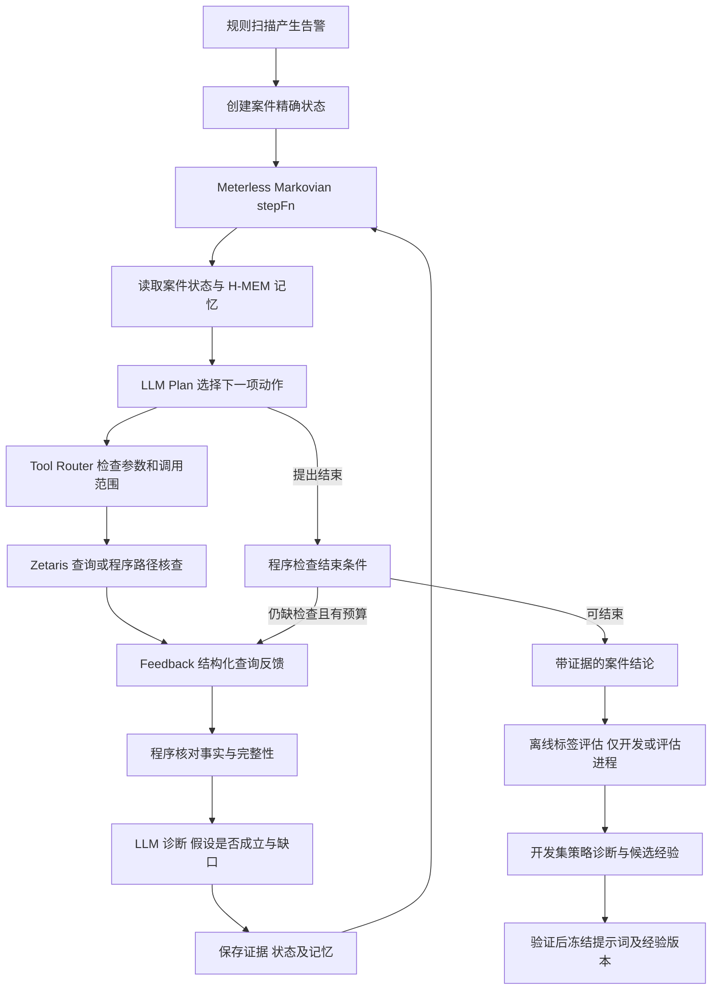

# 交易风险调查 Agent 动态规划技术方案

> 2026-10-22 更新：实现主方案已收敛为 [正式技术实现规范 v1.0](../architecture/AML_Agent_Technical_Spec_v1.0.md)。接口、预算、模型入口、数据划分与已实现状态以新文档为准；本文件保留历史设计。

2026年10月21日

本方案沿用已经确定的 AUSTRAC 规则、IBM 交易字段和九步业务流程。核心实现为 Plan → Tool → Feedback → 诊断 → 记忆 → 下一轮 Plan。Zetaris承担真实数据查询；Meterless Markovian组织执行循环，H-MEM保存可追溯记忆；LLM负责动作选择和调查解释。

首版的“训练”采用开发集上的轨迹评估、失败诊断、提示词及策略更新，不微调模型权重，不搭建强化学习训练平台。运行时调整本案计划，开发时更新跨案件策略；测试时冻结策略版本。

## 一 系统组成



| 组件 | 具体实现 | 负责的内容 |
|---|---|---|
| 前端 | HTML或React，SSE接收进度 | 展示Plan、工具、反馈、诊断、记忆及账户图 |
| 调查服务 | TypeScript与Node.js | 案件状态、Tool Router、模型调用、自动检查 |
| Zetaris Adapter | 优先使用当前租户可用REST接口 | 初筛、上下游、账户历史及政策关联查询 |
| Meterless Markovian | 固定官方参考实现版本 | 逐步执行stepFn、carryover、进度和运行历史 |
| Meterless H-MEM | 固定官方参考实现版本 | 本案事实与调查摘要的写入和召回 |
| 业务存储 | 开发可用SQLite，联调可用PostgreSQL | 保存完整交易证据、案件状态、规则版本和轨迹 |
| 离线评估程序 | Python | 读取标签，计算效果并比较策略 |

Markovian与H-MEM接口已对照官方参考源码；业务函数仍需实现，本文不是已完成的模型或赞助商联调。Meterless参考实现不是一个开箱即用的反洗钱规划器。

## 二 Zetaris与数据怎么接

交易数据保存在Zetaris可访问的文件存储或数据库；规则及政策登记表保存在业务数据库。Zetaris注册两类来源，调查工具通过同一入口读取交易并关联规则来源。跨源能力用于真实不同来源，不为展示而把同一表机械拆分。

运行视图保留transaction_id、event_time、src_bank、src_account、dst_bank、dst_account、amount_paid、payment_currency、amount_received、receiving_currency、payment_format。源行号与快照组成稳定交易标识，账户键为银行与账户组合。

Is Laundering及发布方模式答案置于独立评估数据中，不暴露给Agent工具。运行身份不能绕过视图读取标签。规则表、提示词和调查配置分别版本化。

业务表建议包括cases、case_steps、evidence、query_runs、rule_versions、prompt_versions和memory_outbox。evaluation_results在隔离评估库中。

### Zetaris调用过程

1. Tool Router将经过校验的动作映射为固定SQL模板；LLM不直接提交任意SQL。
2. Adapter发起OpenSqlQuery，保存返回的查询标识。
3. 根据queryToken分页，累计结果并记录是否完整、是否达到预算。
4. 所有已取回结果先持久化，再交给模型摘要；在finally中关闭查询。

官方REST说明的单页pageLimit范围为1至100；“返回400行”需要分页，不能当作一页返回400行。实际端点、认证及响应字段以比赛租户和官方Postman集合为准，不猜测固定URL。

工具预算分别统计逻辑动作、REST请求、返回行数和实际模型tokens。Markovian的maxChunks不能替代这些预算；官方参考实现的token估算也不当作供应商实测用量。

## 三 每个案件保存什么状态

```json
{
  "case_id": "CASE_DEMO",
  "run_id": "RUN_DEMO",
  "split": "development",
  "snapshot_id": "SNAPSHOT_DEMO",
  "rule_package_version": "RULE_PACKAGE_CANDIDATE",
  "planner_prompt_version": "PLANNER_CANDIDATE",
  "policy_memory_version": "PLAYBOOK_CANDIDATE",
  "case_as_of": "由告警或批处理任务确定",
  "evidence_ids": [],
  "queried_scopes": [],
  "frontier": [],
  "hypotheses": [],
  "open_questions": [],
  "budgets_remaining": {},
  "status": "investigating"
}
```

精确状态保存在业务数据库中。queried_scopes记录账户、方向、时间区间、快照、过滤条件及完整性，不只是一个visited账户集合。同一账户的另一个方向或时间范围仍可能值得查询。压缩carryover和H-MEM摘要不能替代原始证据、游标、完整性和预算。

## 四 Plan如何写

每轮只执行一个动作。LLM可以保留后续候选分支，但必须在收到新反馈后重新选择。

Plan输入为正式规则包、本案精确状态摘要、最新Feedback、最新诊断、本案记忆、冻结的通用经验及剩余预算。输出统一结构：

```json
{
  "question": "下游账户是否继续转出或发生回流",
  "action": "query_downstream",
  "arguments": {
    "anchor_transaction_id": "已观察到的交易编号"
  },
  "expected_evidence": "下游新增交易，或完整查询范围内无后续付款",
  "brief_reason": "目前仅确认快速中转，去向尚不明确",
  "evidence_ids": ["已有证据编号"],
  "alternative": "若该方向无新证据，则考虑尚未查过的上游",
  "stop": false
}
```

Tool Router从anchor交易推导账户和允许时间范围；模型不能自行把截止时间向后扩展。brief_reason是可复核的选择依据摘要，不是要求展示模型内部思维。

### Planner提示词骨架

```text
你负责调查本案告警。根据已取得的证据选择下一项动作。
输入：规则包、案件状态、最新反馈、诊断、可用工具、记忆、预算。
目标：回答来源、去向和可疑结构问题，形成有引用的风险结论。

每轮：
1. 指出当前最值得解决的问题。
2. 从允许动作中选择一个，说明预期获得何种证据。
3. 参数必须基于已有交易或账户；不要重复完整覆盖的同一查询。
4. 结果不完整时，优先考虑分页或缩小范围，不能将缺失当作不存在。
5. 假设不成立时更换方向；预算不足时保留未知条件并结束。
6. 不读取标签，不虚构身份、国家、资金来源或经济目的。
按规定JSON输出动作，不输出SQL，不将候选关联交易全部认定为洗钱。
```

## 五 Tool提供哪些动作

下列名称为项目自己的工具适配层，不是声称赞助商已经提供同名接口。

| 动作 | 输入 | 执行方 | 输出 |
|---|---|---|---|
| query_upstream | 已见账户或anchor交易、允许窗口 | Zetaris | 上游入账及来源交易 |
| query_downstream | 已见账户或anchor交易、允许窗口 | Zetaris | 下游付款及去向交易 |
| query_account_activity | 账户及时间范围 | Zetaris | 账户完整收付历史 |
| fetch_more | 本案query_id和有效游标 | Zetaris Adapter | 后续页及完整性 |
| check_structure | 本案已持久化证据编号 | 程序图算法 | 多跳、汇集、往返、时序循环检查 |
| finish_case | 已确认事实、证据编号、未知问题 | 程序与LLM | 案件结论及状态 |

结构检查只对明确输入的已观察图给结论；“已观察图中未发现循环”不等于整个数据库不存在循环。账户自身换汇、同分钟顺序不明、平行交易分别保留，不能人为挑出符合答案的边。

## 六 Feedback必须是什么

Feedback是工具执行的观察，不是洗钱标签或模型自我评价。

```json
{
  "tool_status": "ok",
  "query_id": "Q_DEMO",
  "scope": {"account": "BANK_ACCOUNT", "direction": "outgoing"},
  "complete": true,
  "rows_returned": 0,
  "new_evidence_ids": [],
  "new_account_keys": [],
  "verified_structures": [],
  "pages_fetched": 1,
  "elapsed_ms": 0,
  "error": null,
  "evidence_uri": "本次实际结果的持久化位置"
}
```

示例只说明结构，零行和耗时并非实测。完整性、耗时和标识由程序写入，不由模型填写。

| 返回情况 | 下一步处理 |
|---|---|
| 有新增交易 | 更新证据和frontier，再选择最有价值的分支 |
| 完整查询返回空 | 将该具体范围记为已查，无结果不等于无风险 |
| 返回重复记录 | 合并证据，识别重复范围，避免再次执行相同动作 |
| 分页未完成或结果被截断 | 标记partial，保留游标；考虑分页或拆小范围 |
| 网络或SQL错误 | 标记error；有限重试或修正参数，不推导业务结论 |

## 七 诊断具体怎么做

诊断首先检查“工具执行和证据是否可信”，然后检查“本轮是否回答了问题”。

程序先计算账户和时间是否匹配、结果是否完整、是否新增证据、路径是否成立，以及是否耗尽预算。LLM再基于这些事实判断假设、分支优先级和信息缺口。LLM的结构断言必须有程序结果支持，否则仅保留为待核查假设。

诊断输出：answered_question、supported_findings、rejected_hypotheses、unresolved_questions、suggested_next_actions、memory_candidates。每项事实必须包含evidence_ids或query_id及完整查询范围。

### 诊断提示词骨架

```text
比较本轮调查问题、预期证据、真实工具结果及程序检查。
指出：哪些问题已回答；哪些假设被削弱；哪些问题仍未回答。
列出可选择的后续动作，不替下一轮强制决定唯一方向。
事实必须引用证据；工具失败、零行、截断分别处理。
不要把“存在循环”推导为“已经证明洗钱”。
分别输出可写入事实记忆的内容与仍待验证的假设。
```

首版可使用同一个模型分别执行Plan和诊断，不必建设多个Agent。每轮通常两次模型调用；为控制耗时，空结果、重复结果和明确工具错误可先用确定性诊断模板处理。

## 八 记入记忆的规则

| 记忆类型 | 内容 | 写入条件 | 使用范围 |
|---|---|---|---|
| 本案事实 | 已观察交易、已核对结构、具体范围无结果 | 与持久化证据逐项一致 | 当前case和run |
| 本案待查问题 | 来源未知、分支待查、候选循环 | 明确标注假设，不标为确认事实 | 当前case和run |
| 本案执行经验 | 查询失败原因、已查范围、分页未完成 | 工具反馈可核对 | 当前case和run |
| 通用调查经验 | 某种观察下值得优先使用的工具 | 开发集比较、验证后冻结 | 后续案件的策略提示 |

H-MEM使用add写入带source和provenance的摘要，query召回本案相关记录。每次运行使用独立persistDir与chatId，避免答案或旧状态串入新案件。memory.feedback用于对召回记忆的有用性反馈，不是训练规划模型的奖励接口。

原始证据始终在业务库。业务状态与memory_outbox在同一事务写入；再由写入器推送H-MEM并记录对应memory_id。故障恢复时按outbox去重，避免把重复记忆当作多份证据。推测被否定后更新其状态，不让过时假设持续以事实召回。

通用经验只记录行为与动作关系，例如“多来源汇集后，应检查后续集中转出”，不记录“某个账号就是洗钱账号”。通用经验只能指导查询，不能替代当前案件证据。

## 九 Meterless执行循环如何接

下面是接口示意，业务函数是需要实现的适配层，不是可直接运行的完整应用。Markovian和HMEM方法名对应已核对的官方参考实现。

```ts
const memory = new HMEM({ persistDir: caseMemoryDirectory(scope) });
const engine = new Markovian({
  chunkConfig: {
    chunkSize: 4000, carryoverTokens: 1024,
    overlapTokens: 0, maxChunks: config.maxRounds
  },
  historyDir: caseHistoryDirectory(scope)
});

const run = await engine.run({
  goal: caseGoal,
  mode: "RESEARCH",
  reflect: false,
  stepFn: async ({ carryover }) => {
    const state = await stateStore.load(scope);
    if (budgetExhausted(state)) {
      await saveIncompleteReport(state, "budget_exhausted");
      return { content: safeCompletionSummary(state) };
    }
    const recall = memory.query(state.openQuestionsText, {
      chatId: scope, topN: 5
    });
    const plan = await planner.choose({
      state: runtimeView(state), carryover,
      caseMemory: recall.context,
      frozenPlaybook, rulePackage, toolSchemas
    });
    const check = validatePlan(plan, state, toolSchemas);
    if (!check.ok) {
      // 计入失败次数和本轮状态，下一轮修正；不执行无效工具。
      return await persistRejectedPlanAndCheckpoint(state, plan, check);
    }
    if (plan.action === "finish_case") {
      return await finalizeOrRequestMissingCheck(state, plan);
    }
    const observation = await toolRouter.execute(plan, state);
    const verified = await persistAndCheckObservation(state, observation);
    const diagnosis = await diagnose({ state, plan, verified });
    const safeDiagnosis = verifyDiagnosisReferences(diagnosis, verified, state);
    await saveStepStateAndMemoryOutbox(state, plan, verified, safeDiagnosis);
    await flushCaseMemoryOutbox(memory, scope);
    return { content: safeCheckpointFromPersistedState(scope) };
  }
});
await reconcileEngineStatusWithCaseStatus(run, scope);
```

safeCheckpointFromPersistedState生成官方checkpoint格式；safeCompletionSummary生成官方完成标记。由程序添加控制标记，过滤模型和原始文本中的同名标记，防止提前终止。完成标记表示本轮任务停止，案件还须分别标注已完成、证据不足、预算耗尽或工具失败。

maxChunks、逻辑工具数、REST请求数、模型调用数、行数和重试次数分别限制。原进程重启时从业务库恢复精确状态并启动新run，不声称参考引擎能自动恢复数据库事务。

## 十 动态规划的训练逻辑如何写

### 1 先固定可比较的任务

一个训练单元是一个告警案件episode。相同初始告警、数据快照、截止时间、工具和预算下，比较固定图扩展与候选Planner配置。规则阈值和Planner策略分开版本化；比较规划时不同时更换初始规则，避免无法解释改进来源。

调查发现进入两条独立更新线：规则线提取可复用特征，补充触发条件并校准阈值或权重；规划线调整动作选择、诊断提示词和通用经验。先固定规则比较规划，再固定选定规划比较规则组合，最后联合验证。每次更新都保留此前版本和选择理由，形成HTML中“正式规则确定解释”的依据。

### 2 收集可复现轨迹

逐轮保存state_before、plan、tool_request、feedback、diagnosis、memory_write_ids和state_after；案件结束后保存报告及离线指标。模型供应商、模型版本、提示词、采样参数和工具版本一并保存。

### 3 案件结束后再对照答案

离线评估进程读取开发集标签，统计新增打标交易覆盖、参考模式完整性、候选交易量、重复查询、错误调用、预算和证据引用完整性。标签指标不作为下一轮在线Feedback，不写入本案运行记忆。

目标采用约束优化：在相同查询和模型预算、正确时间范围及证据引用要求下，提高新增标签交易覆盖，再比较候选规模及查询效率。正常交易可能是必要上下文，不能简单把每条标签0交易都当成错误调查。

### 4 将失败归类，再生成少量候选策略

| 失败类型 | 候选改进 |
|---|---|
| 一直沿单一方向，遗漏回流 | 提示词要求检查未解决的另一方向 |
| 在高分支节点耗尽预算 | 调整分支选择，先回答最关键的未决问题 |
| 同一查询反复执行 | 加强范围去重及查询历史反馈 |
| 截断结果被当成完整 | 强制处理partial和分页 |
| 找到结构却给出过强结论 | 加强证据引用及未知条件输出 |
| 过早停止或无限扩展 | 调整结束检查和预算分配 |

离线诊断器可以由LLM归纳失败，但不能只凭其意见发布经验。将建议转换为少量提示词或策略候选，在开发集复跑，选择确有改进的版本；失败案例同样保留，避免只学习成功轨迹。

### 5 验证后冻结经验与提示词

验证集自动运行候选，检查覆盖、候选规模、成本、动作合法性和结论依据。通过预设条件后，将不含账户答案的经验摘要、Planner提示词、诊断提示词及工具配置打包成冻结playbook。H-MEM长期层可承载经验副本，权威版本仍在业务配置库。

验证失败返回开发调整。验证数据被反复用于选择后应视为开发过程的一部分，不把同一批结果当成独立最终成绩。测试只使用冻结playbook，并给每个案件创建干净记忆空间。

### 6 训练过程伪代码

```text
固定规则版本、工具、初始告警和预算
for candidate in 少量Planner提示词与策略配置:
    episodes = 调查开发集告警(candidate, 不可读标签)
    scores = 独立评估(episodes, 开发集标签)
    failures = 按轨迹和评分归类失败
    proposed_lessons = 归纳可复用经验(failures)
    检查经验不含账户答案或测试信息
选择开发集上表现较好的配置与经验
在验证集自动评估并决定发布或返回开发
冻结规则、Planner、诊断、工具及playbook版本
测试运行：每案干净记忆，结束后独立评分，不更新冻结策略
```

这属于带评估反馈的提示词和经验优化，不是模型参数训练。Meterless提供执行和记忆组件，评估器、候选选择与经验发布逻辑需要项目实现。

## 十一 调查示意

初始观察为C→D→E。

| 轮次 | Plan与Tool | Feedback | 诊断与记忆 |
|---|---|---|---|
| 第一轮 | 查C的上游 | 返回B→C | 来源仍可追溯；保存证据，B作为待查分支 |
| 第二轮 | 查E的下游 | 返回E→A | 发现新去向；先标记回流假设，不能直接认定循环 |
| 第三轮 | 查B的上游 | 返回A→B | 账户路径可能闭合；下一步请求程序核查 |
| 第四轮 | check_structure | 程序确认连接和时间顺序，或指出不成立 | 保存结构事实与候选交易歧义，决定是否补查或结束 |

这是说明机制的示意顺序，不是固定脚本，也不作为新实测结果。若任何一次返回为空、截断或出现其他分支，下一轮必须基于实际反馈调整。

## 十二 最小交付与开发顺序

第一天完成Zetaris交易视图、三个查询工具、案件状态、反馈结构及固定基线。第二天接入LLM Planner、诊断和Meterless循环与记忆，跑通真实案件。第三天执行开发验证、冻结规则包和提示词，前端串联Plan、Tool、Feedback、诊断、记忆及结论。另留一天整理比赛展示。

最小交付包括一个可执行循环、可分页的Zetaris Adapter、独立案件记忆、完整运行轨迹、离线评估脚本和冻结版本配置；不增加多Agent编排或模型微调。

## 官方接口依据

- [Zetaris REST查询与分页](https://kbase.zetaris.com/knowledge/rest-api)
- [Meterless Markovian类型及stepFn](https://github.com/Meterless/Meterless/blob/main/engines/markovian/reference/src/types.ts)
- [Markovian实际执行循环](https://github.com/Meterless/Meterless/blob/main/engines/markovian/reference/src/orchestrator.ts)
- [H-MEM add query feedback接口](https://github.com/Meterless/Meterless/blob/main/engines/hmem/reference/src/index.ts)
- [H-MEM写入参数](https://github.com/Meterless/Meterless/blob/main/engines/hmem/reference/src/memoryStore.ts)
