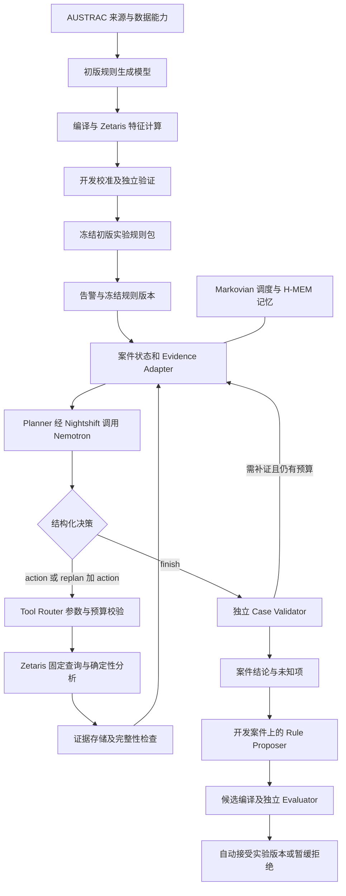

# 交易风险调查 Agent 技术实现方案 v1

> 归档状态：本讨论稿已由 [正式技术实现规范 v1.0](../architecture/AML_Agent_Technical_Spec_v1.0.md) 替代。团队与编码 Agent 按正式规范及其配置实施；本文件保留讨论记录。

版本：2026-10-22，Australia/Sydney。状态：待实施的模型化方案；已有程序基线与真实数据试跑作为起点。

本文是后续实现主方案。旧文档中的时间窗口、接口、预算和实验校准描述如有冲突，以本文及实际实例接口为准。本文不表示已经接入 LLM、Nightshift、Markovian 或 H-MEM。

## 1. 技术决定

采用轻量 Plan + 单步 Action/Observation + 按需 Replan。不使用强化学习或动态规划算法。一个逻辑 Planner 完成初始规划、观察解释、下一动作选择及计划修订；工具自动化和评估器是独立组件。

主模型路径为：本项目 → Meterless Nightshift Runtime → NVIDIA 云端 Nemotron。首选快速 lane，复杂规划允许切换 deep lane；首版也可只启用一个模型。Meterless Markovian/H-MEM 是执行与记忆引擎，Nightshift 是模型服务入口，三者不能互相替代。

交易不进入模型全量上下文。Zetaris/确定性程序先查询、统计、计算图结构，模型读取有范围、有证据引用的 Observation，按需请求明细。17GB 原始数据及约 1.797 亿笔交易继续保存在 Azure，不搬回本机或上传成一段提示词。

独立 Evaluator 分为在线质量校验与离线效果评估。可选模型 reviewer 只提供语义复核意见，不能自行批准全局规则发布。

### 1.1 Agent、Planner、模型与 Nightshift 的关系

“我们的 Agent”指整个调查应用，不是 NVIDIA 模型之外的另一个智能模型。它包含案件入口、计划与状态、模型适配器、工具、证据/记忆、预算、评估和展示。Planner 是其中一个业务组件：提示词 + 输入上下文 + 输出协议 + 调用模型的代码；其推理和动作选择由 NVIDIA 模型完成。

一次实际请求是：调查程序的 Planner 构造上下文 → 模型适配器向 Nightshift Runtime 发请求 → Nightshift 路由到已配置的 NVIDIA Nemotron → 模型返回计划/动作 JSON → 原路返回 → 程序校验并执行工具。Nightshift 是 provider 网关/路由，不是多出来的 Planner；箭头表示调用经过的服务，不代表三个 Agent 轮流思考。没有第二个“本地模型”先规划再让 NVIDIA 重做。

因此，“Planner 使用 NVIDIA 模型”与“应用经过 Nightshift 调用 NVIDIA”描述的是同一次调用的两个层次。底层模型是 NVIDIA；应用入口是 Nightshift；案件工具和证据状态由本项目实现。初始 Plan、每步判断和 Replan 都沿用该调用方式。

### 1.2 完整业务顺序

初版规则构建（政策理解/字段适配 → 规则草案 → 确定性编译 → Zetaris 开发特征 → 参数校准 → 独立验证 → 初版实验规则包）→ 生成告警 → 案件 Planner 调查 → 跨案件规则修改 → 独立再评估。**第一个模型任务是初版规则生成，不是等告警已经出现才开始做 Planner。** 两个角色可复用同一 NVIDIA 模型，但输入、权限、提示词、状态和预算分开。

## 2. 现有实现与尚未实现部分

| 模块 | 已有状态 | 本轮之后要实现 |
|---|---|---|
| Azure 数据层 | HI-Large v8 注册为 `IBM_AML.hi_large_transactions`；调查视图 `aml.transactions` | 查询性能和权限隔离 |
| 业务工具 | `prototype/zetaris_baseline.py` 固定 SQL、按账户方向时间查询、cap+1 截断判定 | 聚合、历史比较、账户间与分段查询工具 |
| 规则与诊断 | `prototype/baseline.py` 白名单特征、快速中转、汇集分发和两跳往返 | 丰富特征 DSL、版本编译与回放 |
| 初版规则生成 | 旧文档有构想，原型的 DEFAULT 是人工固定基线，尚无政策→规则模型链路 | 见第 16 节，Policy-to-Rule Builder 与独立校准/评估 |
| Planner | 固定的 BaselinePlanner，不是 LLM | 模型生成计划、观察后判断、选择动作和 Replan |
| Sponsor 引擎 | 尚未集成 | 官方 Markovian stepFn 与 H-MEM |
| 模型服务 | 尚未配置真实模型凭据 | Nightshift 云模型 lane 与 Runtime 连接 |
| Evaluator | 小样本分组指标及 hold | 独立数据划分、统计比较、发布和回滚 |

已有真实数据证据：五账户双窗口基线查询 22 次，10/10 窗口无截断；正例诊断为三正例加五对照，原规则命中 1/3 正例、对 5/5 对照告警，候选命中 0/3、对照告警 0/5。正例组按标签选样，仅是回顾性诊断。详见 `analysis/README.md` 和 `analysis/README.md`。当前十项测试通过不等于模型调查质量通过。

## 3. 术语与职责边界

这里将“planner ops”理解为规划和动作选择，将“ops automation”理解为执行与调度；它们是本项目术语，不是假定存在同名第三方组件。

| 职责 | 所属组件 | 具体行为 |
|---|---|---|
| 初版检测规则 | Policy-to-Rule Builder（模型角色）+ 编译/校准程序 | 先从政策生成规则草案，经独立评估形成可用规则包；不是案件计划 |
| 初始 Plan | LLM Planner | 根据规则、告警、数据能力生成 2–4 个可检验问题，不固定先查三件事 |
| Observation assessment | 同一个 LLM Planner | 解释新增事实、证据缺口、矛盾和不确定性，不重算金额或证明图路径 |
| 下一动作选择 | 同一个 LLM Planner | 选择工具、已见账户引用、方向和窗口，简述预期回答的问题 |
| Replan | 同一个 LLM Planner 的决策类型 | 修订未完成目标和分支，保留旧版本及理由；不是每步额外调用一次模型 |
| 工具执行 | Tool Router + Python 业务服务 | 检查参数、权限、引用、预算；编译固定 SQL，执行、计算与保存 |
| Ops automation | Orchestrator | 队列、重试、幂等、取消、恢复、记忆 outbox、预算台账；不决定资金调查方向 |
| 在线事实与证据检查 | Case Validator | 范围完整性、时间、图结构及结论引用；反馈结构化问题给 Planner |
| 跨案件规则建议 | 独立 Rule Proposer 阶段，可复用同一模型 | 汇总开发案件后提出假设和可编译差异，不直接改全局规则 |
| 候选效果评估与自动发布 | 独立 Evaluator + Rule Registry | 冻结样本、计算指标、比较候选、接受/暂缓/拒绝、保留回滚 |

程序可以拒绝不合规动作，但不能把“没有入账就必查七天”作为固定业务策略。它应提供扩窗工具和硬边界，由 Planner 根据证据决定。网络重试和截断分片属于执行细节，不需要模型反复规划同一页。

## 4. 整体结构与部署



推荐首版部署：Mac 运行轻量业务服务、TypeScript 编排和 Nightshift；Nightshift 连接 NVIDIA 云端，不下载大模型；Azure VM 继续只承担 Zetaris 与数据。Mac 不运行 Docker 或本地大模型。8GB 是否足够运行这些进程仍需检查实测 RSS、系统内存压力及服务最低要求，不能保证免费云模型就解决所有本地资源问题。

实现选型：Python FastAPI/Pydantic 复用现有查询、特征与评估代码；TypeScript/Node/Ajv 承接官方 Meterless 参考接口及 Planner 决策校验。Python 服务是 SQLite 案件状态的唯一写入方；TS 通过仅监听 loopback、带内部令牌的 HTTP 接口调用业务服务。首版不引入消息中间件。前端只读取计划、动作、证据和指标，不持有模型或 Zetaris 密钥。

若 Nightshift 的实测开销不适合本机，改用另一个受支持且可达的运行主机；不假设该产品已支持当前 Ubuntu VM。应用以后迁至 Azure 时，Mac 的 127.0.0.1 不是 VM 的 localhost：须用经过认证的私网路径或 SSH 反向隧道连接 Runtime，保持 loopback 监听，不公开 8088。此部署迁移不在首版范围。

Zetaris 使用现有 SSH 隧道及 REST `POST /api/v1.0/sql-editor/sqls/run`。当前实例已验证的请求字段为 queryId/sql/source/limit；不再照搬旧文档中未验证的 OpenSqlQuery/queryToken 分页。没有真实 continuation 时，不生成伪分页引用。

## 5. 参赛模型、免费访问与费用核查

### 5.1 已核对的要求

用户提供的 Participant Setup Guide 标注更新于 2026-10-21，第 16–20 页专门要求应用支持 Nightshift 作为主要 AI provider；第 17 页区分 NVIDIA 奖项：须展示通过 Nightshift 实际使用 Nemotron 的功能。第 18 页提供快速与深度两个 lane 示例，并说明名称和可用权限以账号目录为准。[S1]

因此，先前只计划“直接向任意 API 发请求”的方案不足以覆盖指南的主要 provider 要求。我们自行实现适配器和应用逻辑，调用用户配置的服务；不是主办方自动提供一个已为本账号开通的推理网关。公开活动页没有给出可确认的每人模型 credit 数额；不能把 Cursor 编码额度、Azure 余额或参赛免费等同于模型 API credit。[S2]

公开页面存在版本差异：Meterless 社区旧指南仍写 10 月 15–20 日；GenAI.Works 活动页当前写 10 月 22–27 日，提交截止 10 月 27 日 23:45 UTC，即悉尼 10 月 28 日 10:45。比赛日期以活动页和官方账户通知为准。[S2,S3] 这不影响以下技术边界，但不能照旧社区日期判断活动已经结束。

### 5.2 模型候选

| 候选 | 首版用途 | 已确认与待确认 |
|---|---|---|
| NVIDIA `nvidia/nemotron-3.5-lightning-30b-a3b` | 首选 Planner，先测结构化决策和低延迟 | 指南快速 lane 示例；官网显示 Free Endpoint；账户可用与实际 Runtime 路由待验证 [S1,S4] |
| NVIDIA `nvidia/nemotron-3.5-super-vl-120b-a12b` | 复杂初始规划、困难 Replan 或独立语义复核 | 指南深度 lane 示例；官网显示免费原型入口；不假设其必然比快速模型更适合本任务 [S1,S5] |
| Groq 托管 `openai/gpt-oss-120b` 或 `openai/gpt-oss-20b` | 非首选的独立 API 对照 | 官方列有模型和 Free Plan 限制；并非 OpenAI 付费 API，也不能替代 Nemotron 奖项证明；Nightshift provider 支持待检查 [S6,S7] |
| Gemini 有免费层的模型 | 可选对照，不作为当前依赖 | 免费层只覆盖部分型号，数据使用条款与付费不同；具体型号需在账号验证 [S8] |
| OpenAI `gpt-6-luna` / `gpt-6.1-sol` | 低成本或更强的付费对照，不默认启用 | 官方有按 token 计费；API 用量与 ChatGPT/Codex 订阅额度分开；Nightshift 兼容和账号权限另验 [S9,S10] |

推荐决策：先配置 NVIDIA 免费原型端点，快速模型先完成验收；只在确有收益时启用 deep lane。初期关闭多路融合和不可见的模型级联，避免一个应用请求在网关内部变成多次推理。模型选择看工具选择正确率、引用准确率、错误参数率、停止质量、延迟和 token，而非只比较参数规模。候选免费层也可能不适合默认预算：Groq 文档当前为 GPT-OSS 免费层列出 8K TPM；该 provider 的上下文 profile 必须收紧，例如输入硬限 6K、输出预留 2K，并按返回限额排队，不能直接套用 NVIDIA profile 的 12K 输入。实际以本账号限制为准。[S7]

### 5.3 免费不等于无限，也不等于零基础设施费用

NVIDIA 两个模型公开页当前均写免费原型 API；指南也明确受访问限制和条款约束。可优先使用，无须因为“没有 credit”就先充值。尚未登录用户 NVIDIA/Meterless 账号，未验证其 RPM、TPM、日额度、授权和 Nightshift 产品权益；不保证永久免费、额度固定或超额一定不计费。[S1,S4,S5]

免费路由失败时停止或等待，不自动切到付费服务。应用设 paid_fallback=false、仅允许已审核免费 lane。路由名称 cheap/fast/auto 本身不证明免费；须检查底层 provider、模型和可用账号计划。Nightshift 本身的安装/使用权益也应单独确认，不凭名称推断一切免费。

费用分账：Cursor/Codex 编码使用、模型 API、Azure VM/磁盘/网络、Nightshift 服务权益分别记录。Azure 余额不会自动支付 NVIDIA/OpenAI；付费服务是否有市场计费安排需另核实，当前未配置。

### 5.4 接入操作和真实验收

1. 在用户账号取得有 Free Endpoint 的 NVIDIA 模型访问，密钥只放 Nightshift Providers → NVIDIA。
2. 在 Nightshift 建一个明确使用该 Nemotron 的 lane；先只启用这条，避免 auto 混入其他模型。
3. 应用使用 Console 给出的 Runtime URL 和 Runtime token；该 token 与 NVIDIA key 完全不同。Zetaris 的 `.env.local` 继续独立，不能拿它认证模型。
4. 读取 `GET /v1/models`，选择实际发现的 `meterless/*` 路由；模型 ID 是底层名字，路由 ID 是网关名字，不互换。
5. 按 live Power Prompt 实现文本 provider，检查错误 token、发现、真实文本请求与模型回执。先验纯文本 JSON 决策，不假设网关自动转发原生 function calling、json_schema、thinking 参数或完整 usage。
6. 如果仅支持普通文本，要求模型输出一个 JSON 对象，由程序验证；失败最多一次修复。网关若支持原生结构化输出，再启用适配层能力。
7. 用十个固定 mock Observation 验证不同观察能导致不同动作；再做一例真实 Zetaris 调查；保存去密钥的 provider/model/version/receipt。

Live Power Prompt 当前标注 Runtime 1.4/provider v4，GitHub 的短指南仍为 0.90.0，存在版本差异。按指南要求优先 live contract，再对实际安装版本做能力探测与固定。最低文本约定：Bearer、稳定的 meterless-app、chat 的 meterless-scope:user、发现与 chat endpoints、180 秒请求 timeout；详细来源见 [S11,S12]。本方案不复刻网站全部图片/音频/3D 能力。

## 6. Planner 协议与 Replan

每次调用完成“读取 Observation → 更新问题状态 → 选择下一动作”，返回 decision=action/replan/finish。初次调用同时返回 initial_plan 与 first_action，因此不为初始计划单独多付一次调用。每步不是 Reason 调用加 Replan 调用两个固定请求。

计划以问题而非固定工具顺序表示。不同告警可能需要历史异常、汇集、回流或分散调查；不是所有 14 条政策指标都塞进同一模板。14 条是有行业适配限制的定性指标映射，非 14 个法定数值阈值；共享行为特征，避免重复计权。只向模型提供本案适用规则及可计算/不可计算字段。

下面是协议示例，不是已有模型输出：

```json
{
  "decision": "replan",
  "based_on_state_version": 4,
  "previous_plan_version": 1,
  "plan_patch": {
    "add_goals": [{"goal_id":"funding_history","question":"较早时间是否有外部入账？"}],
    "reason_code": "evidence_gap"
  },
  "brief_reason": "当天外部入账为零，不能据此排除更早资金来源",
  "evidence_refs": ["OBS-2"],
  "next_action": {
    "tool": "summarize_account",
    "account_ref": "ACC-1",
    "window_ref": "HISTORY_ALLOWED",
    "direction": "incoming"
  }
}
```

模型不得提交 SQL、修改 as_of、看到隐藏标签或引用未见账户。窗口由 server 提供 allowed ranges；模型可在范围内提出起止时间，经校验变成 window_ref。可以提供 1/3/7 天快捷范围但不是必须顺序尝试。前探交易只能在冻结的 case_as_of 之前，不能为了找到答案读未来数据。

Replan 的业务依据可能是新分支、矛盾、原假设不支持、历史不足或相关规则不适用，由 Planner 识别。程序只对非法引用、过期 state_version、截断、服务错误、硬预算等产生结构化事件。扩窗跨过最大七天、扩展未知账户、改写规则版本会被拒绝。

没有入账只能表述为“指定范围内未观察到”；切换行为假设也不能直接把数据标签当作洗钱原因。模型只输出简短行动依据和证据，不要求保存隐藏思维链。

## 7. 动作工具与 Observation

| 动作 | 计算与输出 | 首版边界 |
|---|---|---|
| get_alert_context | 告警来源、规则版本、触发证据、截止时间 | 不返回标签 |
| summarize_account | 按方向/币种统计次数、金额、对手数、首末时间 | 完整聚合；展示裁剪不影响底层聚合 |
| query_account_transactions | 排序明细、交易 ID、范围、查询状态 | cap+1，支持确定分片后才暴露 continuation |
| compare_account_baseline | 截止前历史与当前的同币种/同口径比较 | 历史不足明确返回，金额用 Decimal |
| query_between_accounts | 两个已见账户直接及反向交易 | 不做任意账户扫描 |
| check_structure | 优先调用 Zetaris 聚合/有界自连接，复杂图分析才对已持久化证据运行本项目算法 | strict 时间顺序、深度/分支上限，不证明同一资金；原生图引擎未确认 |
| get_evidence | 按证据引用取未展示的指定字段 | 只读已授权证据 |
| propose_rule_change | 结构化假设和规则差异，写候选队列 | 不在案件中更新全局规则 |
| finish_case | 结论类别、证据、反例、未知项及停止原因 | 经独立 Case Validator |

check_structure 用结构枚举注册：temporal_path、fan_in、fan_out、gather_scatter、scatter_gather、round_trip、partial_return、cycle。首版只启用经过测试的子集，其余返回 unsupported。小额聚集、频次突变、静默后活跃、整额偏离属于统计/历史工具，不硬塞图算法。统计工具也不能判定客户身份、地理位置、经济理由等缺失字段。

Observation 应包含：query_id、template_version、source_snapshot、schema_version、scope、as_of、status、complete、rows_matched（可未知）、rows_fetched、rows_shown、display_truncated、coverage、verified_findings、evidence_refs、new_account_refs、continuation_ref、elapsed_ms、error_code。

必须区分：只展示部分证据不等于源查询截断；完整聚合也不等于拿到了所有原始行；空结果和服务失败不同。任何裁剪都不能去掉完整性、窗口和未知条件。完整性需由 Adapter 判断，不能让 LLM 猜。

## 8. 大数据怎样进入 Agent

### 8.1 四层数据路径

1. 原始层：VM Parquet 与稳定行号，标签留在评估访问域。保存来源版本和 SHA，不把原始 17GB 输入模型。
2. 查询/特征层：Zetaris 按账户、时间、方向、币种执行固定聚合；优先由 Zetaris SQL 的聚合、窗口和有界连接计算特征与简单结构；服务端仅做结果校验、证据管理及未被平台覆盖的复杂图算法，金额保持 Decimal。
3. 证据层：业务服务持久化查询结果和来源引用，详细行按需读取；模型之外保留完整证据，图状态不靠模型文字描述重建。
4. 上下文层：Context Builder 根据计划问题挑选必要聚合、图摘要和证据片段，形成预算内 Evidence Packet。

不要求先离线人工分析每一笔交易才运行 Agent。需要预先建设的是数据契约、数据质量、特征定义、查询模板和索引/缓存；具体案件分析仍由模型选择工具并驱动。

### 8.2 建议预计算，但不是首轮全表大工程

先在 Zetaris 实现按账户方向的实时聚合并缓存。实测明细每次约 12–15 秒，之前 22 次查询累计约 272 秒；模型再聪明也不能消除源查询延迟。首轮控制串行查询与扫描；后续再按性能数据增加账户-日特征表、账户/时间排序的派生数据或批查询。Zetaris Pipeline 优先承担固定特征、数据质量和重复使用的准备流程；动态案件窗口由服务端工具生成固定 SQL 模板执行。Pipeline 节点图表示计算依赖，和账户交易关系图是不同图；两者均不能替代模型自主调查决策。

派生账户日特征需 source_snapshot、feature_version、closed_at、币种/方向口径。截止到当天中午的案件不能读取全天聚合：仅用已闭合历史桶，再对当前半天单独实时查询。未覆盖的日期或样本不是零。不同币种不相加，银行字符串不转数值，时间精度到分钟不虚构秒序。

### 8.3 Evidence Packet：限制来源与可继续取证

Evidence Packet 是“本轮回答当前问题所需的证据视图”，不是一份重新抽样的数据集。它**不是因为免费 API 只能看 30 条交易**：免费服务主要还有限流/日额度；模型上下文容量、服务请求限制、首 token 延迟、冗余信息、证据可核验性以及本项目成本目标是不同维度。即使付费或支持长上下文，也不应每轮重发所有已见交易。

30 条相关交易、15 个账户节点、25 条摘要边仅是未压测的展示初值，可在真实模型评估后调整，不是模型最大能力、数据全集大小或不可改变的业务上限。首轮先展示较少信息，再由模型 get_evidence/查询工具继续取证；扩大一次展示不需要改规则，也不能自动扩大截止时间或授权范围。

例如一个账户在授权窗口有 10000 笔交易：Zetaris 完整聚合给出真实次数、按币种金额和对手分布；详细交易保留在源与证据检索域。本轮可展示其中 30 条有明确选择依据的交易，并注明 rows_matched=10000、rows_shown=30、display_truncated=true。若某次明细只取回 200/10000，则该次明细 complete=false；不能因为完整聚合成功就宣称一万笔明细均已核验。这个数字例子仅解释协议，不是已实测账户。

展示选择优先触发交易、时间边界、与当前问题相关的支持和反证，以及模型明确请求的明细。排序规则版本化，记录 omissions/selection_reason，避免总挑“看起来可疑”的证据。未知源总数可以为 null，不用展示行数充当总数。

这里有三个独立概念：源查询覆盖多少、证据存储实际获取多少、模型这一轮看见多少。源查询截断需要补取/分片；显示裁剪可通过证据引用继续读取；业务窗口之外的记录从未查询，不能称已检查或被 API 截断。

节点和边超限时提供 frontier 摘要及可检索引用，模型决定扩哪个分支。未展示账户通过 frontier/get_evidence 成为已见引用后才可使用。单案账户/深度硬预算与可调整的显示条数不同；碰到硬边界应报告预算耗尽或证据不足，而不是偷偷漏掉后续。

对结构化交易使用 Zetaris SQL/特征/关系查询；不把整表 embedding 当精确金额与时序检索。政策和调查经验可检索，必须保留来源/版本。H-MEM 和 carryover 提供导航及历史压缩，事实和精确金额以证据库/确定性结果为准。

### 8.4 Meterless 优先复用，案件适配只补必要部分

| 管理内容 | 优先复用 | 本项目仅需补什么 |
|---|---|---|
| 多轮执行、分块、最大 chunk 数、停止/取消入口 | Markovian | 将案件步骤接入 stepFn，调用前检查业务权限和预算 |
| 跨轮历史压缩、carryover 上限与状态标记 | Markovian Carryover Service | 给出合规的简短 checkpoint；用证据引用保留可恢复事实，不重写通用压缩器 |
| 案件与调查经验记忆检索 | H-MEM add/query/feedback | 限定 tenant/case/split/as_of、来源与记忆类型；记录检索结果 |
| 模型 provider 与路由 | Nightshift Runtime | 账号配置、发现、适配和真实模型回执 |
| 哪些交易与当前问题相关 | 案件 Evidence Adapter + Zetaris | 语义选择、聚合、反证、完整性；通用压缩器不了解本项目证据含义 |
| 精确 token/付费额度、SQL 请求和查询预算 | 优先读取可用 provider/Runtime usage 和限制；应用做业务台账 | 源码参考 token 值为估算，不能当账单；补缺少的调用前预扣、真实用量结算及 SQL/图/时间边界 |

因此不是“全靠自己实现预算”，而是**引擎负责通用上下文管理，应用适配业务范围并校验真实用量**。现已核对的 Markovian 参考实现提供 maxChunks/carryover/压缩/停止接口，但没有证明它能替我们准确硬限制所有第三方费用和 SQL 扫描。Nightshift 实际安装版本若提供相应可验证的预算服务，优先使用并让业务台账引用其 receipt，不再建立一套重复的限额执行机制。[S13,S14,S16]

不要把搜索到的其他同名 Nightshift 产品的 budget CLI 当 Meterless 功能。当前 Meterless 安装与账号仍未联调，本节是经官方源码核查后的接入设计，不是已有能力测试通过。

## 9. 上下文、token 与执行预算

以下全部是待压测的开发初值，不是政策阈值或供应商权益。8K/12K 是应用运行 profile，不是“免费模型只有这么大窗口”；模型及网关上限、账号 RPM/TPM、交互延迟目标分别核查。机器可读草案见 [agent-budget.example.json](agent-budget.example.json)，不是已生效的限额实现；按实际 provider profile 取更严格上限。

### 9.1 每次请求

目标输入不超过 8,000 tokens，硬上限 12,000；模型总输出含供应商计入的 reasoning/completion 不超过 2,048。用户可见 JSON 目标 800 tokens，余量给供应商推理。若网关/模型不支持总输出或 thinking 上限，须禁用可选 thinking 或标为预算能力不满足，不能假装参数已生效。

| 上下文区 | 规划分配上限（tokens） |
|---|---:|
| 系统约束与工具 schema | 1,500 |
| 本案政策、规则与适用限制 | 1,200 |
| 当前精确状态及未完成问题 | 1,500 |
| 新 Observation、聚合和证据片段 | 2,500 |
| 图 frontier | 1,000 |
| 检索到的历史记忆 | 800 |
| 最近行动及失败摘要 | 700 |
| 格式和短提示余量 | 800 |
| 合计 | 10,000 |

分配是上限不是每轮填满；正常压到 8K。硬限 12K 为 tokenizer 差异、schema 包装等预留，但仍需发送前计数。不得按“字符数÷4”当准确中文 token；优先对应模型 tokenizer。不可得时用保守字节上界加余量，记录估算，最终以服务 usage/receipt 校准。

超过软限时先去旧对话和重复工具说明，再压缩已完成目标、减少展示证据与记忆、保留持久化引用。不得裁掉截止时间、权限、预算、完整性、关键反证或当前问题。仍超过硬限则不发请求，返回 context_budget_exceeded；不是静默截断最后几千字。

### 9.2 单案件与单次运行

| 预算维度 | 首版初值 | 执行方式 |
|---|---:|---|
| 实际模型 HTTP 请求数 | 最多 10 | 初始规划含首动作；结束报告合并 finish；重试/修复同样占额 |
| 业务工具动作数 | 最多 8 | 一次动作可能含多个物理请求，分开计数 |
| Replan 次数 | 最多 2 | 在上述模型调用内，不额外获得免费调用 |
| 历史范围 | 截止前最多 7 天 | 是允许边界，不要求固定扩大到七天 |
| 网络拓展 | 深度 3、每次新增最多 5 个账户、本案最多 20 个 | 只允许从已有证据发现 |
| 单明细结果 | 最多持久化 200 行，取 201 行判定截断 | 超限须分片或缩小范围；不能宣布不存在 |
| 物理 SQL 请求 | 最多 16 | 重试、分片、聚合都计入 |
| SQL 同时在途 | 1 | 先尊重当前 VM 资源 |
| SQL 正常延迟目标 | 30 秒内 | 是性能目标，不是已支持的服务取消 |
| SQL 客户端等待上限 | 180 秒 | 属于待实现 Adapter 配置，当前旧 helper 是 600 秒；不等于取消服务器查询 |
| 模型 HTTP timeout | 180 秒 | 源于 Runtime 文本约定，不保证实际延迟 |
| 单案件墙钟时间 | 最多 12 分钟 | 下一请求前预留 timeout；到期不派新动作 |
| token 总额 | 输入 120,000 + 输出 20,480 | 10×每请求硬上限，包含可观察的内部推理用量 |
| 模型请求并发 | 1 | 账号 RPM/TPM 更低时再收紧 |
| 付费回退 | 关闭 | 免费 route 不可用时等待/失败，不能偷偷换付费 |

重试每个动作最多一次，但仍受总额约束。401/403 不重试；429 尊重 Retry-After 且检查剩余时间；其他网络错误查请求状态再决定。超时不证明服务端已停，不能立即重复大扫描。十二分钟为应用不再派发请求的运行截止；连接超时后源查询可能仍在服务器运行，需以可验证状态报告 outstanding，而不能承诺服务器资源已回收。未得到实测用量的 in-flight 请求预扣最大额度，返回后结算；缺 usage 不记为零。Nightshift 若有内部级联须纳入 receipts，无法观测则不宣称严格控制底层总 token。

初始模型调用可选择第一个工具，后续每轮观察+下一动作，finish 合并最终报告，避免固定双调用。独立 reviewer 如启用另有最多两次请求的账本，不能挤占或绕过 Planner 上限；批量 Rule Proposer 同样独立预算。

### 9.3 费用公式与示例

费用 = 各实际请求的输入/缓存输入/输出计费 token × 对应单价 + 显式工具或路由费用。cached input 计价另记；推理 token 按供应商口径计入，不只看最终可见句子。

NVIDIA 免费原型 route 内预计模型调用费用为零，前提是账号确实有该免费资格；仍记录用量、限流和 Azure 成本。

仅为付费对照说明：官方 OpenAI Standard 价格当前列 `gpt-6-luna` 输入 $0.10、输出 $0.50 / 百万 tokens。按本案最坏输入 120,000、输出 20,480、不计缓存优惠，约 $0.02224/案件；20 案约 $0.4448。这个算例不含其他 reviewer、Rule Proposer、工具/网关费用、税费和基础设施，也不代表应用已经开通此模型。[S9] 默认仍不启用付费服务。

## 10. 状态、记忆和 Meterless 执行循环

SQLite 保存精确状态，至少包括 cases、plans、case_steps、tool_runs、evidence、observations、model_calls、budget_ledger、rule_versions、memory_outbox、evaluation_runs。主键含 case/run；案例保存 snapshot、as_of、split、rule/prompt/feature 版本。原子提交 observation+evidence+预算+新 state_version 后再供模型读取。

每轮由案件 Evidence Adapter 注入新增 Observation 和精确业务约束，旧过程上下文优先使用 Markovian carryover 和 H-MEM 检索；不另建一个与 Markovian 重复的完整对话摘要循环，也不把全部历史不断追加。H-MEM 只存有出处的短记忆、已排除分支和可复用调查经验；按 tenant/case/split/as_of/policy_version 过滤。标签、正例选择信息、最终测试结果不得混入调查记忆。H-MEM confidence 不能当洗钱概率。记忆写失败走 outbox，不使已完成查询重跑。

默认 stepFn 在提交业务状态后，由程序生成短 checkpoint 标记交给 Markovian 的官方 carryover 路径；不让自动截断决定金额、完整性或未完成问题的真实状态。可恢复的事实仍在业务库。如果启用 injected compressorFn，该模型调用也通过统一预算适配器，计入请求、token 和费用，不能因为“引擎内部压缩”就不记账。首版默认不注入模型压缩器，避免隐藏调用；引擎内置确定性路径与字段校验配合使用。[S13,S14,S16]

Markovian 是外层唯一模型化调度循环。stepFn 内依次：读状态 → 检查剩余预算 → 构造上下文 → 模型决策 → 校验 → 至多执行一个业务动作 → 持久化 → 返回 checkpoint。replan+next_action 仍只有一个动作。停止采用程序验证后的业务状态。

参考实现默认 reflect 可能再次调用同一生成器，因此首版设置 reflect:false，避免重复执行带副作用的 stepFn。stopWhen 在 chunk 后判断，不能替代调用前硬预算。chunkSize 先设 16000、carryoverTokens 1024、overlapTokens 0、maxChunks 10；这些为引擎协调参数，不是供应商真实 token 计费器或完整上下文大小。具体启动配置需用固定 commit 的实现验证。[S13,S14]

H-MEM 参考实现是最小实现，不能当完整生产数据库；使用其真实 add/query/feedback 接口并固定源码版本。[S15] 官方 conformance 与业务恢复测试分别报告。Markovian history 不能代替业务事务。动作幂等键含 run_id/plan_version/规范参数/snapshot；崩溃恢复先读取已完成动作，避免重复写候选或重新执行昂贵查询。

## 11. Evaluator 独立设计

### 11.1 在线 Case Validator：无标签、确定性

每次工具返回先校验作用域、时间、完整性、账户键、币种和引用。结束时检查每个重要结论是否有已保存证据，partial 不能声称穷尽，未回答的问题须明确未知。输出 pass/needs_evidence/invalid，不直接把“模型自己说合理”当通过。

可选 Reviewer：以独立 prompt/调用读取同一证据包，寻找遗漏和 unsupported claims，可复用同一底座模型但不共享私有决策对话；这只是逻辑独立，并不保证模型错误独立。首版默认不启用，先避免费用翻倍。

### 11.2 离线效果 Evaluator：独立标签域

Planner 结束后，评估进程读取标签或发布方模式答案。调查工具身份不能读标签。当前管理员 key 仅实现程序层隔离，必须补最小权限；若平台不能列级隔离则另设无标签物理来源/凭据，评估器独立访问原始来源。未完成之前仅称开发隔离，不能称生产隔离。

分开评估：规则告警质量、调查证据覆盖/链路重建、Planner 有效工具选择与成本、事实性与终止质量。账户窗口标签不等于精确交易命中；规则报警某账户也不证明模型重建了洗钱链。路径覆盖指标只有在相应真值可获得且定义一致时报告。

样本分为：已知正例回顾性 smoke（调试）、开发集（设计规则/阈值/提示词）、冻结验证集（一次候选批次比较）、最终测试集（最后报告）。现在已看过的八窗口仅作调试，不再充当独立验证。反复查看验证结果做候选会污染验证集，应消耗验证批次或重新保留未触及样本，不能只禁止改一行代码却继续隐性调参。

正式样本在标签之外预先确定账户/时间抽样；可额外用分层正例样本覆盖稀有行为，但报告采样概率、分层权重和适用范围，不能从人工平衡的正负样本直接给总体 precision。时间切分使用截止前可用信息，网络关联账户可能跨集泄漏，需报告并设置账户/组件隔离或 purge/embargo；无法完全隔离时按关联组件 bootstrap 而非把每个交易当独立样本。

### 11.3 规则更新是独立动作阶段

案件只提交 evidence-backed proposal；跨案 Rule Proposer 读取开发案件摘要，输出 base_version、operation、feature_ids、表达式差异、policy_refs、支持/反例、预期收益、风险和成本。

允许的变更类型分阶段实现：修改阈值/时间窗；添加或删除特征条件；有上限的权重修改；AND/OR 或分组组合；新增规则；停用冗余规则。新增特征必须先注册确定性提取器、类型/单位/币种/缺失语义/可用截止时间、测试和代码版本；模型提出特征不等于自动可执行。禁止任意 Python/SQL，禁止标签代理、未来量或重复特征重复计分。政策语义本身不因调参而改写。

Evaluator 自动执行：DSL/schema/权限/政策适配等硬门槛 → 开发样本参数搜索 → 冻结候选 → 验证回放 → 等告警预算/等工具预算对比 → 预设准则 → accept_for_experiment/hold/reject。缺数据、区间太宽或正例不足是 hold，不假装效果为零。明显违反边界或性能回归可 reject。

首版质量门槛仍只作为开发初值：验证不少于 100 个账户窗口、至少 10 个正例、证据完整、等预算下真阳性提高且 precision 不降低，才可接受实验版本。它不足以自动满足生产资格；正式启用更严格的样本量/置信区间、场景覆盖、回归/成本准则，全部在观察验证结果前固定。LLM reviewer 无权跳过数值门槛。

通过后 Registry 原子写新版本，仅新案件使用；旧案件版本固定。保留旧规则和自动回滚条件。当前原型没有部署生产规则库，production_eligible 始终 false，不能把 hold 的 JSON 当已实现上线流程。后续自动实验发布无需设置人工审批步骤。

## 12. 异常、观测与前端呈现

案件状态区分 completed、insufficient_evidence、budget_exhausted、tool_failed、model_unavailable、cancelled。completed 指调查过程按目标结束，不意味着确认洗钱。

前端展示问题清单、当前计划版本、一步动作的简短依据、观察与覆盖范围、已核验结构、未知项、剩余预算和底层模型回执。模型请求失败不能切回固定程序后仍显示“AI 调查完成”；基线降级必须显式标为 deterministic baseline。

日志保留实际 provider/model/route/version、prompt/schema hashes、usage 来源、预算预扣/结算、SQL 模板与参数、query_id、结果校验值、数据版本、取消/错误。密钥不入日志，不记录原始 connect link。业务数据最小化发送；当前 IBM 是合成数据，未来真实金融数据需重新确定云模型权限和数据处理条件，不沿用免费测试配置。

## 13. 实施顺序与验收

0. **初版规则链路**：按第 16 节建立政策段落注册、字段/能力映射、模型规则草案、确定性编译、开发校准与独立初版评估；缺阈值时不得把默认值伪装成已生成的可用规则。模型接通是运行该步骤的前置依赖。
1. **模型接通**：Nightshift Providers/lane/Console 完成配置；应用发现、认证、纯文本 JSON、底层 Nemotron 回执通过。若账号权限/内存不满足，停在真实缺失项，不报成功。
2. **工具和上下文**：扩展当前 Python adapter，先聚合后按需取证；实现 state/version/budget/证据包。用 mock 覆盖空、部分、错误、证据不足；确认 201 行时返回 partial，30 行展示时保留真实完整性。
3. **真实 Planner**：类型化初始 plan/action/replan/finish；用同一接口的两个固定 Observation 确认下一动作可以不同，且没有程序替它固定调查方向。验证窗口、已见引用和 schema 失败修复上限。
4. **引擎接入**：固定 Meterless commit 和 Runtime 版本；stepFn、H-MEM outbox、恢复和 conformance，reflect:false；重启不重跑已提交动作。
5. **真实案件**：对已知正例做回顾性功能诊断；只要求能产生合理动态动作、证据和未知项，不要求为追标签强行命中。将初始与 Replan 的差异作为真实模型能力证据。
6. **独立评估**：重新冻结未看过的开发/验证/测试范围，比较固定基线与 Planner，报告规则效果、链路证据、有效动作、延迟、成本和置信区间。
7. **规则闭环**：新增候选 DSL、编译、自动实验版注册与回滚；显式模拟“降噪但漏掉正例”的候选被拒绝/暂缓，不能只展示通过分支。

首批待新增模块：`services/aml-api`（Python）、`services/orchestrator`（TS）、`schemas/planner-decision.schema.json`、`schemas/observation.schema.json`、`configs/agent-runtime.json`、`evaluations/`。这些为计划路径，本次没有宣称已建好。

不默认安装 Nightshift、开通付费账户、创建新 Azure 资源或发起模型调用；本次交付为实现方案与可验证配置草案。

## 14. 来源与核查记录

S16–S17 为本次补充来源，列在第 16 节末；8.3/8.4 已澄清展示预算和引擎职责。

全部网络来源核查日期 2026-10-22；账号权益未经登录核实。引用只支持紧邻的服务/接口/活动事实，本文预算、职责、数据架构和评估门槛是本项目设计。

- [S1] 用户提供的 Participant Setup Guide，更新日期 2026-10-21，第 16–20 页为 Power 规则和配置，第 12–15 页为编码与引擎区别。原文件为主办方提供的 PDF（未入库）。
- [S2] [GenAI.Works 活动页](https://hackathon.genai.works/event/open-agent-hackathon-2026)，活动日期、合作工具、NVIDIA 奖项；未找到可确认的个人模型 credit 金额。
- [S3] [Meterless 社区旧日期指南](https://github.com/Meterless/Meterless/blob/main/docs/community/hackathon-guide.md)，与活动页日期不同，不用于当前截止时间。
- [S4] [NVIDIA Lightning 模型 API 页](https://build.nvidia.com/nvidia/nemotron-3.5-lightning-30b-a3b)，模型 ID 和 Free Endpoint。
- [S5] [NVIDIA Super VL 模型 API 页](https://build.nvidia.com/nvidia/nemotron-3.5-super-vl-120b-a12b)，模型 ID 和免费原型入口。
- [S6] [Groq 模型目录](https://console.groq.com/docs/models)，GPT-OSS 120B/20B 等当前型号。
- [S7] [Groq 限流文档](https://console.groq.com/docs/rate-limits)，Free Plan 和 RPM/TPM/RPD/TPD，具体以组织账号为准。
- [S8] [Gemini API 价格与免费层](https://ai.google.dev/gemini-api/docs/pricing)，部分模型免费及免费层数据使用条款。
- [S9] [OpenAI API 官方价格](https://developers.openai.com/api/docs/pricing)，示例用 Standard 定价，不采用 Flex/Batch/Fast/Ultrafast 价。
- [S10] [ChatGPT Learn 价格](https://learn.chatgpt.com/docs/pricing)，订阅使用与 API token 价格区分。
- [S11] [Meterless live Power Prompt](https://meterless.ai/engines.html)，Add Meterless as a provider，当前展示 Runtime 1.4/provider v4。
- [S12] [GitHub provider 简版约定](https://github.com/Meterless/Meterless/blob/main/docs/agent-ready/add-meterless-provider.md)，当前仍标 0.90.0，不覆盖 live 版本差异。
- [S13] [Markovian orchestrator 实现](https://github.com/Meterless/Meterless/blob/main/engines/markovian/reference/src/orchestrator.ts)，循环、停止、reflection 与持久化。
- [S14] [Markovian 类型](https://github.com/Meterless/Meterless/blob/main/engines/markovian/reference/src/types.ts)，stepFn、chunk 配置。
- [S15] [H-MEM 最小参考接口](https://github.com/Meterless/Meterless/blob/main/engines/hmem/reference/src/index.ts)，非生产数据库。


## 15. 补充决定：优先使用 Zetaris 的特征与简单结构计算

2026-10-22 补充。先前文字容易让人理解成“Zetaris 只取数、所有计算都搬到 Python”。修订为：**查询、聚合、窗口特征和有界关系连接尽量在 Zetaris 完成，应用保留业务定义、校验、编排及平台未覆盖算法。** SQL 模板仍需我们定义，不等于平台已经内置 AUSTRAC 反洗钱规则。

| 业务需求 | 优先使用的 Zetaris 能力 | 确认层次 |
|---|---|---|
| 收付次数/金额/对手数、首末时间 | SQL COUNT/SUM/MIN/MAX/COUNT DISTINCT，按币种方向分组 | 官方文档 + 当前实例小账户实测 |
| 交易间隔、前后交易、历史窗口 | SQL LAG/LEAD、OVER/PARTITION/窗口；较复杂 SQL 放 SQL Table/Custom SQL | 官方文档；当前实例已测 LAG，其他具体函数按需验证 |
| fan-in/fan-out | 按收款/付款银行和账户聚合，统计不同对手 | 基于聚合能力设计，精确口径由我们提供 |
| A→B→C 的时间关系 | 有界自连接，银行+账户匹配，时间严格递增 | 当前实例小账户两边时序连接实测；非同一资金认定 |
| A→B→A 或固定三跳闭环 | 增加端点约束/有界多次 JOIN，保留交易 ID 和时间条件 | SQL 可表达的候选实现，具体查询和性能尚待实测 |
| 固定特征流和质量检查 | Pipeline Projection/Join/Aggregation/Custom SQL/SimpleDQ，视实例可用模块 | 官方 Pipeline 文档及用户界面；本次未创建或运行可视 Pipeline |
| 任意深度遍历、社区发现、最短路、全图环检测 | 暂不宣称有 Zetaris 现成业务 API；必要时本项目有界算法 | 所查官方材料未确认，不等于证明绝对不支持 |

官方依据：[Zetaris SQL Manual](https://kbase.zetaris.com/knowledge/sql-manual) 说明聚合、连接及窗口；[Virtual Pipeline Guide](https://kbase.zetaris.com/knowledge/virtual-pipeline-guide) 说明图形转换、聚合和 SQL Table。文档也有图形编辑器限制，不能把 SQL 能力直接等同于每个 GUI 节点都接受所有表达式。平台使用 Spark 相关 SQL 也不足以推断已暴露 GraphFrames/GraphX API，本方案不另开本地 Spark 冒充赞助商能力。

小账户只读探针：`analysis/zetaris_feature_capability_probe.sql`。通过已有 REST runner 执行，无标签读取、无 CREATE、无 Pipeline 或规则修改。聚合、LAG、有界两边连接的具体实测记录另存 `analysis/README.md`。这些通过只能证明当前 SQL 形态和账户窗口，不能证明 1.8 亿行全表图运算性能。


## 16. 初版检测规则如何生成（调查之前的独立阶段）

本节“初版规则”指第一次生成的交易监测规则包，不是初始调查 Plan，也不是后续 Rule Proposer 对现有规则的修改。当前 `prototype/baseline.py` 的 DEFAULT 和候选条件是人工预置基线，不能冒充模型已从政策生成规则。

### 16.1 输入契约与角色

Policy-to-Rule Builder 可复用 Planner 使用的同一 Nemotron，通过 Nightshift 调用；但使用独立 prompt、run_id、状态、记忆 namespace、输出协议与预算。它不承担某个账户的逐步调查。

输入包含：已注册的 AUSTRAC 原文段落、来源 URL/章节/定位、快照/hash/取得日期；IBM HI-Large 实际字段字典及缺失条件；经验证的 Zetaris 模板/函数能力；feature registry（类型、单位、币种、缺失值、所需历史和截止时间语义）；规则 DSL、参数搜索空间及开发任务目标。初版生成器不读标签，也不读取本次三个已知正例的选择信息。

R01–R14 采用 `docs/IBM反洗钱调查项目可行性报告.md` 的 IBM 适配映射作为当前候选指标清单。Rxx 是项目编号，不是官方法规编号。旧 `analysis/records/rule_registry.json` 属于 PaySim，编号、字段和业务含义不同，不能按同名 R01 直接复用；正式注册时加 dataset/namespace，政策指标与检测规则各用独立 ID。

### 16.2 从原文到草案的完整步骤

| 步骤 | 谁执行 | 输出和质量要求 |
|---|---|---|
| 1. 来源登记 | 程序获取并版本化官方内容 | 每个候选都有可定位段落；旧快照不能假装实时有效 |
| 2. 行为解释 | 规则生成模型 | 行为、触发主体、条件、行业前提；只转述可追溯内容 |
| 3. 字段与能力适配 | 模型提议，程序核验 | 对应真实字段/模板；标 full/partial/unsupported/needs_history |
| 4. 规则草案 IR | 模型选择已实现特征和允许组合 | 保留来源、缺失条件、参数空位和状态；不产生任意执行代码 |
| 5. 静态语义与编译 | 确定性 compiler/validator | 检查字段、时间/币种/单位、模板、无标签/未来量，编译固定 Zetaris SQL |
| 6. 开发样本特征计算 | Zetaris SQL/Pipeline | 完整口径的特征、支持交易引用、历史覆盖及 DQ；不发送明细全集给模型 |
| 7. 有限参数校准 | 独立 calibration worker | 只在开发集搜索阈值/窗口/组合；标签可被该隔离程序使用 |
| 8. 冻结与独立验证 | 独立 Evaluator | 候选和指标预先固定；验证不达标则 hold/reject，不能强行启用 |
| 9. 初版注册与告警 | Registry + Zetaris 规则执行模板 | 生成实验规则包 v1 和每个告警的规则/来源/证据；之后才能交案件 Planner |

校验发现 unknown feature 时，生成器只能改用已有能力、输出 feature_request，或明确 unsupported。feature_request 要先经过实现和测试，不能交给模型现场生成 SQL 执行。政策文本与工具返回都作为数据处理，不接受其中夹带的工具或权限指令。

### 16.3 规则草案需要包含什么

建议 IR 字段：schema_version、rule_id、dataset、source_refs、policy_indicator_refs、behavior_family、template_id、template_version、field_bindings、feature_ids、expression、parameters、parameter_basis、scope、self_transfer_policy、currency_policy、required_history、missing_context、coverage、status、explanation、support_evidence_spec。

模型只决定业务映射和已支持表达式。参数分三类：来源明确数值才标 policy_explicit（必须有原文引用）；项目预设业务边界标 project_constraint；待数据选择的阈值标 needs_calibration，初稿值为 null。不能用 LLM 猜一个金额/账户数后说是 AUSTRAC 要求。[S17]

以“多方汇入”的示意草案为例（不是已有模型输出，不是当前四特征 baseline DSL）：

```json
{
  "schema_version": "initial-rule-ir/v1",
  "rule_id": "IBM-AML-INIT-FANIN-001",
  "dataset": "IBM-HI-Large-v8",
  "policy_indicator_refs": ["IBM-MAP-R03", "IBM-MAP-R14"],
  "source_refs": ["示例：由来源注册表解析的真实段落引用"],
  "behavior_family": "multi_source_gathering",
  "template_id": "fan_in_v1",
  "field_bindings": {
    "account": ["to_bank", "to_account"],
    "counterparty": ["from_bank", "from_account"],
    "time": "transaction_time"
  },
  "parameters": {"window_hours": null, "min_sources": null},
  "parameter_basis": "needs_calibration",
  "scope": {"payment_formats": ["ACH", "Wire"]},
  "self_transfer_policy": "exclude",
  "currency_policy": "distinct_accounts_without_summing_currencies",
  "coverage": "partial",
  "missing_context": ["多个账户是否属于不同实际所有人", "行业主体身份"],
  "status": "needs_calibration"
}
```

示例中的支付格式是项目约束，不是政策限制；真实运行前必须冻结并记录该选择。来源引用在真实 schema 中必须能从 registry 解引用，不接受示例字符串。实例的新 `COUNT DISTINCT`、`LAG` 与有界 JOIN 已测试，但对应完整生产模板和此 IR 编译器尚未实现。

### 16.4 14 条指标如何进入首版，而不是全部强制启用

先逐条完成来源/字段适配，再按共享行为家族合并，保留多来源引用但不把相近指标重复加权。候选家族包括快速中转、多来源汇集、大额短时入账、小额聚集、往返/部分返回、历史突变、观察静默后活跃和整额偏离。行业/客户/经济理由等未提供字段不得用银行、币种或猜测替代。

首批实现 fan_in、fan_out、receive_then_send 三个模板作为可计算入口，关联哪些指标由真实源段落及适配检查确认；不宣称三个模板已覆盖全部 14 条。循环和更复杂网络结构先作为调查工具，避免全表暴力搜索。历史不足的规则输出 needs_history，而非零风险；缺失上下文的规则明确只覆盖可观测行为。

首次启动允许某些家族停用或全部草案尚未通过：此时可以演示草案与失败原因、手动指定账户的调查功能，但不能把人工指定账户包装成规则自动发现。

### 16.5 初版阈值与规则组合校准

首版不让模型凭空设置“几个账户/多少小时/多少金额”。开发程序在预先固定范围内有限搜索。例如 fan_in/out 窗口 24/48 小时、对手数 3/5/10，各六个配置，加停用各七种；receive_then_send 最大间隔 6/24/48 小时，加停用四种。最多 7×7×4=196 个组合，不无限生成候选。

这些是实验搜索例子、非官方阈值，尚未在 HI-Large 上校准。Zetaris 优先一次计算最大历史范围的可复用统计，再派生较小窗口或批量候选，不能把 196 个组合实现成 196 次无约束全表扫描。金额规则后续按币种和足够历史计算开发分位数，未定义分位数算法和缺失语义前不启用。

告警按账户/观察日聚合且记录触发模板和支持边。仅计算截止前可用记录，严格排除自转账与未来量。需要 48 小时历史的首次观察窗口若源开始前历史缺失，标为不可评估，不填零。候选组合可能重复命中同一交易/账户，聚合后再计算处理负担。

开发校准目标先固定，例如每日最多 50 个合并告警的演示处理预算，在满足成本/完整性约束下最大化开发正例覆盖，以更高 precision/更少查询作为并列决胜；50 是未实测项目初值。若只对抽样账户计算，就只能使用样本告警预算，不能冒充全平台每日负担。

标签指标需明确粒度。当前 smoke 的账户窗口标签只能用于账户窗口指标；首版正式规则验收同时记录“告警支持交易中是否有新增已标记交易”及“规则支持边覆盖的正例交易”，与整个账户当天任意交易为正的宽标签分别报告。开发标签不会进入模型提示词、特征或 H-MEM。

### 16.6 初版也必须经过独立 Evaluator

初版生成器、calibration worker 和 Evaluator 分为不同步骤。前者给草案；校准程序只用开发数据选参数；Evaluator 用冻结验证范围检验政策适配、质量、同预算效果和不确定性。初版没有旧生产规则时，与预登记简单基线及停用方案比较，不能仅因为比“零告警”找到更多正例就自动通过。

使用第 11 节的分割、预算、证据与统计要求。数据不够或基线比较无结论则 hold。通过者首先生成 experiment_v1，生产资格另验；当前原型 production_eligible=false 的事实不改变。初版实验版本注册与后续更新共享 Registry/编译器/Evaluator，但 run_type=bootstrap 与 run_type=revision 分开，前者没有 base_version，后者必须引用它。

通过后冻结 source/feature/template/parameter/compiler/data_snapshot 版本，再生成告警。Planner 获得的是规则及其适用限制，而不是一条没有来源的布尔表达式。后续调查提出的新特征或组合回到 revision 流程，不能原地覆盖最初政策解释。

### 16.7 预算与验收

初版构建是一次批任务，不为每个案件重做。按 2–4 条相关指标分组生成，初版模型 HTTP 请求总上限 12 次（含修复和复核），单次预算沿用被选 provider profile；Markovian maxChunks=12，carryoverTokens=1024，reflect=false。压缩若使用模型也占这 12 次，不能偷偷额外调用。每次 schema 不合法最多修复一次。

参数组合上限 196 交开发计算程序，不逐组合调 LLM。大型开发回放单独设查询/时间/样本预算并记录执行计划；本轮没有授权发起全表调参或新增计算资源，不承诺在现有 VM 上未经压测就快速完成。

首批验收覆盖：正常来源能生成可编译草案；不存在字段/身份条件被标不支持；未知阈值保留空位；无源数值不冒充政策；同编号 PaySim/IBM 不混用；开发校准后参数齐全；验证失败不注册可用包；规则包冻结后才允许告警；模型生成记录与人工 baseline 明确区分。

补充官方来源：

- [S16] [Markovian Carryover Service 源码](https://github.com/Meterless/Meterless/blob/main/engines/markovian/reference/src/carryover.ts) 及 [效率模型](https://github.com/Meterless/Meterless/blob/main/engines/markovian/docs/efficiency-model.md)，状态承接和上下文增长控制。效果数字是模型化估算，不当真实账单。
- [S17] [AUSTRAC 银行业可疑活动指标](https://www.austrac.gov.au/industry-and-business/education-and-resources/publications-and-resources/indicators-suspicious-activity-banking-sector)，本文仅用其可追溯行为指标做模板适配，不将本项目参数写成法规要求；其余行业来源仍见 14 条指标清单，初版构建时逐段注册。
