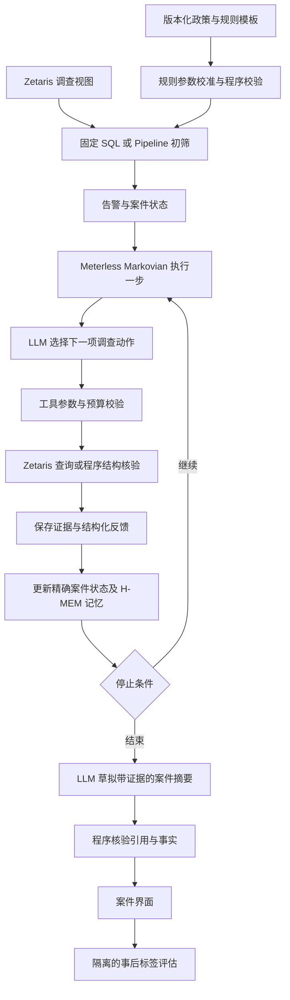

# 交易风险调查 Agent：整体架构与 Zetaris Pipeline 分工

设计日期：2026-10-22。本文是实现设计，不代表 Agent、Meterless 或模型接口已经完成接入。

规划和工具的后续细化见 [Agent规划与执行动作详细设计](Agent规划与执行动作详细设计.md)。采用轻量 Plan、单步 Action/Observation、按需 Replan；另设跨案件规则迭代循环，支持阈值、特征、权重、组合和新增规则，不做强化学习。

## 1. 决策

第一版采用一个调查 Agent：应用服务运行动态调查循环，Zetaris 执行受控数据查询，Meterless Markovian 管理有界步骤与交接状态，H-MEM 保存有来源的案件记忆。Zetaris Pipeline 可承载固定的数据准备、数据质量和初筛流程，不作为第一版的主要调查编排器。

依据：Zetaris 官方 Virtual Pipeline Guide 将其定位为图形化数据转换、准备、虚拟输出或持久化工具。当前界面也有 RAG 节点，但本项目尚未验证其动态循环、工具回调、恢复和预算控制能力；不能据此宣称它完全不支持 AI，也不能宣称它已经提供完整调查 Agent。

官方参考：https://kbase.zetaris.com/knowledge/virtual-pipeline-guide
Meterless：https://meterless.ai/engines.html
既有设计：`Agent动态规划技术方案.md`、`IBM反洗钱调查项目可行性报告.md`。

## 2. 已完成与待实现

已完成：Azure VM 4 vCPU / 16 GiB / 128 GiB，Zetaris Docker 部署及 REST 连接，IBM HI-Large 179,702,229 笔交易，完整表和不含标签视图，基本查询与数据完整性验证。

待实现：规则服务、调查工具适配器、案件状态库、LLM 调用、Markovian 与 H-MEM 的业务接入、界面、分区评估与权限隔离。

`aml.transactions` 是当前调查视图，字段为 transaction_id、transaction_time、from_bank、from_account、to_bank、to_account、amount_received、receiving_currency、amount_paid、payment_currency、payment_format。
`IBM_AML.hi_large_transactions` 另有 is_laundering，仅供隔离评估使用。
当前 API 凭据属于管理员；单纯不在视图中展示标签不等于权限隔离。应用上线前必须建立不具备读取标签或任意 SQL 权限的运行身份，验证越权请求失败。

## 3. 整体流程

政策生成规则和案件调查是不同阶段。规则优化只能发生在开发与验证阶段，测试时冻结规则、提示词和经验版本。第一版不在每次调查中自动修改全局规则。

## 4. Pipeline 实际用于哪里

| 工作 | 第一版执行位置 | 原因 |
|---|---|---|
| 字段选择、时间过滤、同币种聚合 | Zetaris SQL，必要时画成 Pipeline | 固定、可复核、适合在数据侧处理 |
| 数据字段及空值质量检查 | SQL / 经验证的 SimpleDQ 节点 | 检查数据，不代替调查逻辑测试 |
| 初始规则扫描与告警输出 | 先实现版本化 SQL；Pipeline 作为可选图形化表示 | 避免维护两份不同逻辑 |
| 根据新证据决定查上游或下游 | LLM Planner + 应用服务 | 每个案件的步骤和方向会变化 |
| 步数、查询数、时间与模型用量预算 | 应用服务 | 预算必须由程序执行 |
| 案件精确状态、断点恢复、证据 | 业务数据库 | 摘要或节点连线不足以保存完整证据 |
| 有界状态交接与记忆召回 | Meterless + 业务适配代码 | 需要真实接入并运行 conformance 检查 |
| 路径和时间顺序核验 | 确定性程序 | LLM 不负责精确资金计算或宣布路径成立 |
| 模型输出及规则效果评估 | 独立测试和评估程序 | Pipeline 的 Validate 不能证明 Agent 正确 |

RAG 节点以后可用于政策文档检索，须先验证具体节点、模型接口及输出。1.8 亿笔结构化交易通过 SQL 按案件范围查询，不逐笔转成向量或全部送入模型。

## 5. 一次调查如何调用 LLM

1. 固定规则或用户指定银行加账户和截止时间，建立案件；规则输出行为异常，不预先宣布洗钱。
2. 程序读取已确认事实、未解问题、查询完整性和剩余预算。
3. LLM 输出一个结构化动作及简短依据；不输出任意可执行 SQL。
4. Tool Router 使用固定模板查询 Zetaris，时间上限来自案件状态，不由模型扩展。
5. 程序保存明细，核验账户连接、交易 ID、时间顺序、币种和数据是否截断。
6. LLM 在有新证据时更新假设或选择新方向；明确空结果和工具错误优先使用确定性反馈，减少无效模型调用。
7. Markovian 交接下一步所需状态；完整证据仍在业务库，H-MEM 记录带来源摘要。
8. 完成问题、无新证据或达到预算后结束；LLM 生成引用交易 ID 的摘要，程序核对引用和结构断言。

同一模型即可承担首版规划与汇总，不默认拆成多个并行 Agent。模型服务通过独立适配器接入；Meterless Engine 的接入不等于模型推理服务已配置。

## 6. 首版工具与状态

工具：query_upstream、query_downstream、query_account_activity、check_structure、finish_case。分页或续取能力以当前实例实际 API 为准；任何截断结果必须标记 partial，不能用截断的零结果或不完整路径支持否定结论。

账户键：银行编号加账户编号，两者均按字符串保留前导零。
金额：按币种分别统计，不跨币种直接求和；不将时间相邻的收付认定为同一笔资金。

案件表至少保存 cases、case_steps、evidence、query_runs、rule_versions、prompt_versions、memory_outbox。
每步记录 case_as_of、动作、参数、证据 ID、查询范围、完整性、简短依据、预算变化、错误和耗时。记录可审计的依据，不要求暴露模型内部思维。

状态和证据以 SQLite 起步，部署在应用服务端；H-MEM 不是唯一状态库。Markovian 的 carryover 和 H-MEM 的摘要不能代替精确交易、查询范围、游标或预算。

## 7. 性能与数据分区

当前 Parquet 未建立面向账户查询的专门索引，LIMIT 返回少量行也可能扫描大量数据。不能由简单 SELECT 成功推断全量自连接和动态多跳已经可交互运行。

先实测按账户、时间窗口的查询延迟和读取范围，再决定是否按日期重新分区、预计算每日账户特征或准备可复用邻接数据。第一版不执行无时间边界的全表多跳自连接，不把 1.8 亿行缓存到 2GB 查询引擎堆中。

数据按时间划分开发、验证和测试，先核对实际日期分布及尾部记录，再冻结边界和历史回看规则。不能直接复用 HI-Small 的九月切分，也不能将所有跨年尾部记录无条件视为正常训练样本。H-MEM 的跨案件经验按 split 和版本隔离。

## 8. 实施顺序与验收

1. **一个真实账户的受控工具闭环**：读视图，查询上下游和历史，保存证据并测延迟；核验与 SQL Editor 结果一致。
2. **一个真实模型驱动的动态案件**：至少展示两种因反馈不同而选择不同下一步的分支；保留调用记录。脚本固定流程或 mock 模型不称为真实 Agent 成功。
3. **Markovian 与恢复**：通过官方 conformance，程序重启后从精确状态恢复，预算不重置，避免重复执行已完成步骤。
4. **H-MEM**：需要跨步召回时接入，摘要有证据来源，并测试隔离和冲突；如采用则运行官方 conformance。
5. **初始规则与界面**：先选少量经数据验证的规则，显示告警、动作、证据图、未知项和运行状态。
6. **开发验证与冻结测试**：比较初始规则、固定扩展、真实 LLM 动态扩展；分别报告新增覆盖、候选规模、成本和失败。调查结束后才由隔离评估程序读取标签。

每一步以实测结果推进；Pipeline 可在固定数据处理阶段补充，首版不以画完整大流程图作为前置条件。
